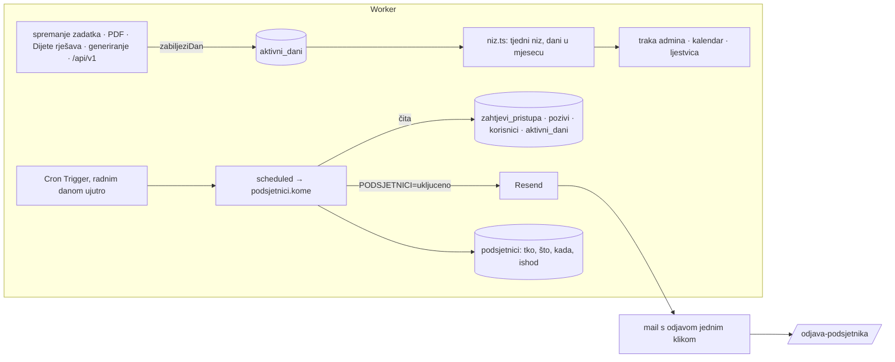

# Plan: angažman (podsjetnici e-poštom, niz, ljestvica)

## Zašto

Superadmin odobrava pristup, ali dio ljudi nikad ne postavi prijavu (pozivnica vrijedi 72 h i tiho istekne), a dio
se prijavi i ne napravi nijedan zadatak. Danas za njih ne postoji nikakav trag ni podsjetnik: tko je zapeo vidi se
tek ručnim upitom u bazu. Cilj je (1) automatski i pristojno podsjetiti ljude u svakoj fazi lijevka, (2) dati
redovitim korisnicima razlog da se vraćaju (niz tjedana korištenja) i (3) kasnije, uz pristanak, prijateljsko
natjecanje (ljestvica). Sve se isprobava na stagingu; produkcija je zadnja sesija i iza vrata.

## Arhitektura

| Segment | Tko | Što dobije |
| --- | --- | --- |
| A | zahtjev odobren, pozivnica nije iskorištena | nova pozivnica (stara opozvana) |
| B | ima račun, nema nijedan aktivni dan | „prvi zadatak”: predlošci, kratki put do PDF-a |
| C | bio aktivan, pa 14 dana ništa | povratak: što je novo, link na zadnji zadatak |
| D | uključio podsjetnik niza, ovaj tjedan još ništa | „niz ističe” (F2) |

## Tvrdi uvjeti (svaka sesija)

- **Javni repo.** Nikakvi e-mailovi, imena, sadržaj zadataka ni ključevi u gitu, fixtureima, istraživanjima ni
  commit porukama. Brojke samo zbirno. Fixturei koriste `primjer.test`.
- **Staging prvo.** Svaki paket završava na stagingu (`npm run deploy:staging`). Produkcija samo u S7, iza vrata.
  Staging D1 je kopija produkcije s pravim adresama: slanje tamo štiti `smijePrimiti` (samo admini, +aliasi,
  @logomedo.com), a cron na stagingu svejedno počinje s `PODSJETNICI=suho`.
- **Nikad više od jednog podsjetnika po osobi u 7 dana**, nikad superadminima, nikad nakon odjave, svaka poruka ima
  odjavu jednim klikom. Pravila su u čistoj funkciji s testovima, ne razbacana po upitima.
- **Idempotentno.** Dva pokretanja crona istog dana ne šalju dvaput (`podsjetnici` UNIQUE po osobi, vrsti, koraku).
- **Bilježenje aktivnosti ne smije srušiti ni usporiti radnju korisnika** (ne baca, `waitUntil` gdje treba).
- **D1 podaci na produkciji ne bez pitanja** (memorija projekta); migracije na produkciji samo u S7.

## Sesije

| # | Faza | Paket | Odluke | Gotovo kad |
| --- | --- | --- | --- | --- |
| S0 | — | Plan | 1–12 | plan, TODO, handoffi u repou; koda nema |
| S1 | F0 | Lijevak na stagingu, istraživanje (cron, odjava, pravna osnova), revizija segmenata | 100 | `research/…-lijevak.md` s brojkama po koraku i naredbom kojom su dobivene; `research/…-cron-odjava-pravo.md` s izvorima; odluke 100+ potvrđuju ili mijenjaju 4–8 |
| S2 | F0 | `aktivni_dani` + `zabiljeziDan` na svim radnjama + backfill | 200 | testovi zeleni, `skipped 0`; na stagingu backfill upisao N redaka (broj u napomeni) i nova radnja admina vidljiva u tablici |
| S3 | F1 | Cron, pravila segmenata, slanje, obnova pozivnice, odjava, predlošci | 300 | testovi za svako pravilo iz decisions 5; staging e2e: testni korisnik na +aliasu u svakom od A/B/C primi točno jedan mail, drugo pokretanje ne šalje ništa, odjava jednim klikom upisana |
| S4 | F1 | `/admin/uprava/podsjetnici`, uključi/isključi u Postavkama, nacrt `/privatnost` | 400 | stranica na stagingu pokazuje lijevak i suhi popis; korisnik u Postavkama isključi podsjetnike i suhi popis ga više nema; pitanje za vrata upisano na vrh `S5.md` i `S7.md` |
| S5 | F2 | Niz: izračun, prikaz, proslave, `/api/v1/ja`, segment D | 500 | testovi niza (godina, DST, prazan tjedan); na stagingu plamičak i kalendar za testnog korisnika s backfillom |
| S6 | F3 | Ljestvica (opt-in, nadimak, prag sudionika) | 600 | testovi rangiranja i skrivanja; na stagingu dva testna korisnika s nadimkom na ljestvici, treći bez pristanka nije |
| S7 | F4 | **(vrata)** produkcija: migracije, suho pokretanje, uključivanje, dokumentacija | 700 | korisnik pregledao suhi popis; prvi stvarni mailovi u Resendu `delivered`; `docs/angazman.md` |

**Procjena:** 7 sesija nakon S0. **Vrata:** nakon S4 (tekstovi mailova, odlomak `/privatnost`, ton; korisnik i Anita)
i na početku S7 (uključivanje na produkciji). S5 i S6 mogu ići prije odluke na vratima, jer su samo staging.
**Paralelno:** S5 i S6 dijele `Postavke` i traku admina, pa ne; sve je linearno.

**Najrizičnije:**

- **S1** jer brojke mogu pokazati da je problem drugdje (npr. gotovo svi postave prijavu, a nitko ne napravi zadatak),
  pa se težište seli s A na B; zato S1 smije prepisati odluke 4–6.
- **S3** jer prvi put uvodi cron i automatsko slanje; greška u pravilu znači mail pravim ljudima. Zaštita: `suho`
  prvo, `smijePrimiti` na stagingu, UNIQUE u bazi, globalno ograničenje u čistoj funkciji.
- **S6** jer ljestvica među logopedima može djelovati kao nadzor; zato opt-in i prag sudionika.

**Trošak:** nema LLM poziva u kodu. Resend: broj mailova po danu mjeri S1 iz lijevka (prije uključivanja usporediti
s limitom plana). Subagenti po sesiji: 2 (implementacija, testovi), Opus 5.5.

## Gdje smo

S0 (25. 11. 2026.): plan, koda nema.
