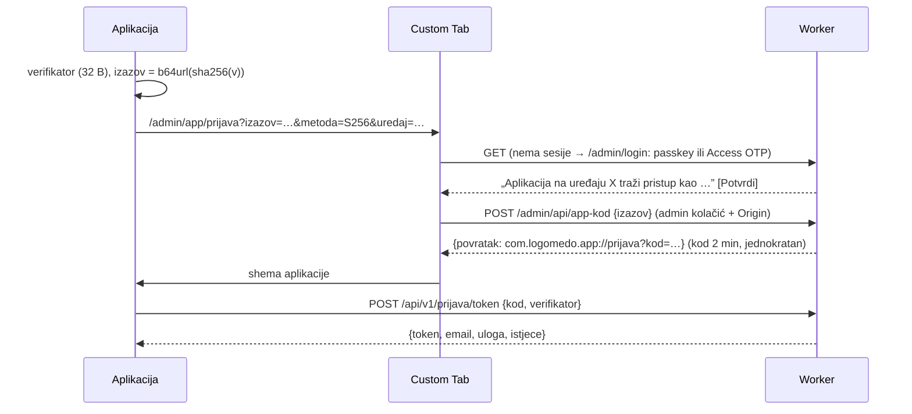

# API za mobilnu aplikaciju (`/api/v1`)

Klijent je Flutter aplikacija u `../app` (Android i iOS). Ovaj dokument je ugovor između njih.
Web admin (`/admin/*`) ostaje kako jest; `/api/v1` je zaseban ulaz s vlastitom prijavom.

## Pravila

- **Samo bearer token**, kolačići se na `/api/v1` ne gledaju. Zato nema CSRF provjere, a
  ukradeni web kolačić ne otvara API (i obrnuto).
- Token je nasumičan (32 B), u D1 samo sha-256 (`app_sesije`). Vrijedi 30 dana od prijave i
  prestaje nakon 7 dana bez korištenja. Odjava ga briše.
- **Uloga se izvodi pri svakom zahtjevu**, ne sprema se: `admin` = e-mail u `ADMIN_EMAILS`.
  Micanje iz popisa odmah gasi i web i aplikaciju. Kasnije `logoped` iz tablice računa.
- `/api/v1/admin/*` traži ulogu `admin`: middleware, pa još jednom svaka ruta (`admin(ctx)`).
- Samo `ADMIN_HOST` (logomedo.com) ili localhost; drugi host dobiva 421.
- Polja su hrvatska i ista kao u bazi (`opis_za_sliku`, `odobrena_id`). Greška je uvijek
  `{ "error": "…" }`; za 400/409 kod uploada poruka je za korisnika.
- Verzioniranje: aplikacija šalje `x-logomedo-api: 1`. Nekompatibilna promjena = `/api/v2`
  uz `/api/v1` dok stare verzije ne nestanu. `GET /api/v1/ja` vraća `min_build`; aplikacija
  starija od toga traži nadogradnju (zasad 1, `src/lib/app/api.ts`).

## Prijava (PKCE preko preglednika)

Aplikacija ne zna ništa o Accessu ni passkeyima: koristi postojeću web prijavu u Custom Tabu
(Android) ili `ASWebAuthenticationSession` (iOS). Kod se vraća na shemu `com.logomedo.app`.
Bez verifikatora koji nikad ne napušta aplikaciju kod ne vrijedi ništa, pa ga ni druga
aplikacija koja bi presrela shemu ne može iskoristiti.



- Potvrda je izričit klik: sama posjeta stranici ne izdaje kod.
- Preusmjeravanje na shemu ide iz JS-a nakon klika, ne kao 303 iz forme: CSP `form-action 'self'`
  u Chromeu blokira i preusmjeravanje forme na drugu shemu.
- Kod se briše pri prvom pokušaju zamjene, bez obzira na ishod (krivi verifikator ga troši).
- Povratna adresa je fiksna u kodu (`APP_POVRATAK`), nikad iz zahtjeva.
- **Potvrđeno na produkciji 1. 11. 2026.** (Xiaomi 17 Ultra): sesija u `app_sesije`, kod potrošen.
  Aplikacija dobiva identitet onoga tko je već prijavljen u pregledniku uređaja (tamo je bila
  Anitina passkey sesija, pa je i aplikacija njezina). Detalji: `../app/docs/2026-11-01-prvi-test-na-uredajima.md`.

Kasnije (nije napravljeno): App Link `https://logomedo.com/app/...` umjesto sheme i native passkey
kroz Android Credential Manager. Oboje traži `/.well-known/assetlinks.json` s SHA-256 otiskom
ključa za potpis s Playa (Play App Signing), pa ima smisla tek nakon prve objave.

## Rute

| Metoda | Putanja | Što |
|---|---|---|
| POST | `/api/v1/prijava/token` | `{kod, verifikator}` → `{token, email, uloga, istjece}`; 400 `invalid_grant` |
| GET | `/api/v1/ja` | `{email, uloga, uredaj, istjece, api, min_build}` |
| POST | `/api/v1/odjava` | 204, briše token |
| GET | `/api/v1/admin/katalog?stil=` | `{stil, stilovi[], glasovi[] (s brojevima), ukupno}` |
| GET | `/api/v1/admin/glasovi/{slug}?stil=` | `{stil, glas, rijeci[]}` (pozicija, `odobrena_id`, kandidata, u_redu) |
| GET | `/api/v1/admin/rijeci` | indeks za tražilicu `[{r, s, o, k}]` |
| GET | `/api/v1/admin/rijeci/{slug}` | detalj: pozicije, `slike[]` s `url` (API) i `cdn` (samo odobrene), `red[]` |
| POST | `/api/v1/admin/rijeci/{id}/slike` | multipart `slika, stil, prompt, alat` → 201 `{slika_id}` (kandidat) |
| GET | `/api/v1/admin/slike/{id}` | datoteka iz privatnog R2, `immutable` |
| POST | `/api/v1/admin/slike/{id}/odluka` | `{akcija: odobri\|odbij\|vrati, razlog?, ponovi?}`; 409 + `vec` ako je netko bio brži |

Napomena: `rijeci/{slug}` (GET) i `rijeci/{id}/slike` (POST) dijele datoteku `[id]` u Astru;
GET prima slug, upload brojčani id.

## Lokalno

Access lokalno ne radi, pa debug build aplikacije na localhost serveru ima polje „Dev token”:

```bash
npm run build && npx wrangler dev --port 8787   # ili npm run preview
scripts/app-token.sh                            # token u lokalni D1, ispiše ga
adb reverse tcp:8787 tcp:8787                   # telefon vidi localhost:8787
```

Aplikacija: `flutter run --dart-define-from-file=config/dev.json` (u `../app`).
