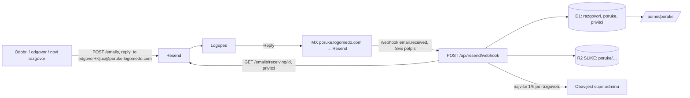

# Inbox: odgovori na mailove iz LogoMeda

Logopedi odgovaraju na mailove koje šalje aplikacija (pozivnica, odgovor iz admina, prvi mail novog razgovora).
Odgovori stižu kroz Resend u D1 i R2, superadmin ih čita i odgovara na `/admin/poruke`. Odgovore piše čovjek:
aplikacija ništa ne odgovara sama. Plan i povijest odluka: `docs/inbox/` (`plan.md`, `decisions.md`).

## Kako radi

- **Nit** drži ključ u adresi za odgovor `odgovor+<kljuc>@poruke.logomedo.com` (26 znakova base32 po razgovoru);
  rezerva su `In-Reply-To`/`References` (SES `message_id` naših mailova), pa e-mail pošiljatelja. Nepoznato ide u
  novi razgovor „neraspoređen”; ništa se ne baca.
- **Slanje:** pozivnica `pozivnica@logomedo.com`, odgovori i novi razgovor `bok@logomedo.com`, obavijesti
  `obavijesti@logomedo.com`. Predlošci `emails/*.tsx` → `npm run emails` → `src/lib/emails/generirano.ts`.
- **Admin** (samo superadmin, ovlast `korisnici`): `/admin/poruke` (popis, brojač u bočnoj traci, polling 12 s),
  `/admin/poruke/[id]` (nit, HTML u sandbox iframeu, privitci kroz `/admin/poruke/privitak/[id]`, odgovor s
  Idempotency-Key), `/admin/poruke/brzi` (brzi odgovori, `/kratica` + Tab), `/admin/poruke/novi` (novi razgovor;
  „Napiši” na `/admin/zahtjevi`).
- **Obavijesti** (`src/lib/obavijesti.ts`): nova dolazna poruka i novi zahtjev na `/pristup` → mail na sve adrese iz
  `ADMIN_EMAILS`, samo s linkom (bez imena i sadržaja), najviše jedan na sat po razgovoru, odnosno za zahtjeve.
- **Retencija** (`src/lib/poruke-retencija.ts`): pri otvaranju `/admin/poruke` brišu se razgovori 24 mjeseca nakon
  zadnje poruke (`PORUKE_ROK_MJESECI` u `src/lib/poruke-rokovi.ts`, isti broj kao `/privatnost#dopisivanje`), s
  privitcima u R2, i prazni razgovori stariji od dana.

Kod: `src/lib/poruke.ts` (D1), `src/lib/poruke-webhook.ts` (webhook), `src/lib/svix.ts` (potpis),
`src/lib/email.ts` (slanje), `migrations/0039_inbox.sql`, `migrations/0040_obavijesti.sql`.

## DNS

| Zapis | Vrijednost | Čemu služi |
| --- | --- | --- |
| `MX poruke` | `receive-euw1.forge.rmta.net`, 10 | primanje (zaseban Resend domain `poruke.logomedo.com`, samo primanje) |
| `TXT resend._domainkey.poruke` | iz Resenda | DKIM poddomene za primanje |
| `TXT resend._domainkey`, `send` MX+TXT, `rsend` CNAME | iz Resenda | slanje s `logomedo.com` |
| `MX @` | Google (5 zapisa) | `bok@logomedo.com` u Gmailu; **ne dirati** |
| `TXT @` SPF | `v=spf1 include:_spf.google.com include:_spf.firebasemail.com ~all` | Gmail (`bok@`) i stari app (Firebase, ukloniti kad stane) |
| `TXT google._domainkey` | još ne postoji | Google DKIM, generira se u Google Adminu (S5, čeka korisnika) |
| `TXT _dmarc` | `p=none`, izvještaji u Cloudflare DMARC Management | `quarantine` tek nakon Google SPF/DKIM i 2–4 tjedna izvještaja |

DNS se mijenja u Cloudflare dashboardu (račun D.O.M.); wrangler OAuth nema pravo na DNS.

## Secreti (samo produkcija)

- `RESEND_API_KEY`: slanje i dohvat tijela/privitaka. Lokalna kopija: `~/.config/logomedo/secrets.env` (izvan repoa).
- `RESEND_WEBHOOK_SECRET`: Svix potpis webhooka (Resend webhook `email.received` na `https://logomedo.com/api/resend/webhook`).
- `ADMIN_EMAILS`: superadmini, ujedno primatelji obavijesti.

Staging nema ni ključ ni pravi webhook: ne šalje i ne prima ništa (admin javlja „slanje nije uključeno”).

## Kako testirati

- `npm test` (bez mreže; fetch se ubacuje, svježa D1 po testu): `poruke*.test.ts`, `svix.test.ts`, `email*.test.ts`,
  `obavijesti.test.ts`, `poruke-retencija.test.ts`.
- Staging webhook: `RESEND_WEBHOOK_SECRET=… node scripts/inbox-probni-webhook.ts https://staging.logomedo.com`
  (ključ u `~/.cache/logomedo-staging/inbox-webhook-secret`).
- Izgled admina lokalno: `astro dev` + `.dev.vars` s testnim `ADMIN_EMAILS` + sesija u lokalnom D1 + `playwright-core`
  (odluka 311 u `docs/inbox/decisions.md`). Lokalno nema ključa, pa slanje javlja grešku i ne upisuje ništa.
- Produkcija: pravi mail samo na vlastite adrese. Stanje poslanog: `GET https://api.resend.com/emails?limit=5` s
  ključem iz `secrets.env` (ne ispisivati ga). Probne retke (`@primjer.test`) poslije obrisati iz D1.
