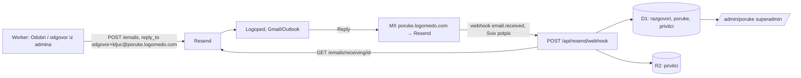

# Plan: inbox za transakcijske mailove

## Zašto

LogoMedo šalje transakcijske mailove (pozivnice, kasnije obavijesti) iz aplikacije kroz Resend. Kad logoped
odgovori, odgovor danas završi u Gmailu (`bok@logomedo.com`) i dopisivanje se raspe po osobnim pretincima.
Cilj: svaki odgovor na mail iz aplikacije stiže u D1, superadmin ga vidi i odgovara iz `/admin/poruke`, a
cijela korespondencija s logopedima ostaje u bazi, s brzim odgovorima za česta pitanja.

## Arhitektura

Ključ niti je adresa za odgovor `odgovor+<kljuc>@poruke.logomedo.com` (nasumični ključ po razgovoru); zaglavlja
`In-Reply-To`/`References` su druga linija, e-mail pošiljatelja treća.

## Tvrdi uvjeti (svaka sesija)

- Apex MX i SPF `logomedo.com` ostaju Googleovi; primanje je samo na poddomeni `poruke.logomedo.com`.
- Repo je javan: nikakvi e-mailovi, sadržaj poruka, ključevi ni webhook secret u gitu ni u testnim fixtureima
  (samo `primjer.test`).
- Staging nema `RESEND_API_KEY` ni webhook: tamo se ne šalje i ne prima ništa; testira se potpisanim fixtureima.
- Webhook bez ispravnog potpisa vraća 401 i ne piše ništa. Isti `email_id` dvaput ne stvara dvije poruke.
- Sadržaj poruka je osobni podatak: samo superadmin (`smije(uloga, "korisnici")`), nikad u `aktivnost` ni logove.
- Prije commita `npm test && npm run check && npm run build`.

## Sesije

| # | Faza | Paket | Odluke | Gotovo kad |
| --- | --- | --- | --- | --- |
| S1 | F0 | Istraživanje, migracija, Svix, `poruke.ts`, webhook ruta | 100–199 | `research/` odgovara na 3 pitanja s izvorom; testovi zeleni (+ novi za svix, webhook, niti), `skipped 0`; staging deploy, potpisani fixture na staging webhook → 200 i red u staging D1, nepotpisan → 401 |
| S2 | F1 | Infra primanja, Reply-To, privatnost, e2e | 200–299 | `dig MX poruke.logomedo.com` pokazuje Resend; webhook postoji (`GET /webhooks`); stvarni odgovor iz Gmaila je u produkcijskoj D1 s tekstom i privitkom u R2 |
| S3 | F2 | `/admin/poruke`, nit, odgovor, brzi odgovori | 300–399 | e2e na produkciji: odgovor iz admina stigne u Gmail u istoj niti; odgovor na njega opet u istoj niti u D1; brzi odgovor umetnut; mobilni prikaz provjeren |
| S4 | F3 | Retencija, obavijesti superadminu, novi razgovor, SPF/DKIM, dokumentacija | 400–499 | retencija pokrivena testom; obavijest stiže; `docs/inbox.md`; SPF apexa uključuje Google (ili zapisano da čeka korisnika) |

Procjena: 4 sesije. Vrata: S2 (DNS u Cloudflare dashboardu i uključivanje primanja u Resendu, ako API to ne
podržava; e2e odgovor iz pretinca radi korisnik ili Claude u Braveu na korisnikov zahtjev) i S4 (Google Admin DKIM
je korisnikov). Paralelno: ništa, svaki paket gradi na prethodnom. Najrizičnije: S1 (ako Resend ne propušta
`In-Reply-To`, nit kod logopeda se raspada, ali ključ u adresi i dalje drži nit u D1) i S2 (MX i primanje).

Trošak: Resend besplatni plan (3000 mailova mjesečno) je dovoljan; LLM poziva nema.

## Gdje smo

S0: plan, koda inboxa nema. Polazište je `main` s pozivnicom e-poštom i React Emailom (`7be67c9`).

S1 (`f9c1cec`): migracija 0039, `svix.ts`, `poruke.ts`, webhook `/api/resend/webhook`, research; staging provjeren
probnim potpisanim webhookom. Produkcija još ne prima ništa (nema MX ni webhooka).

S2 (`d3e8251`): `poruke.logomedo.com` je zaseban Resend domain (samo primanje), MX i DKIM u Cloudflareu, webhook i
secret na produkciji, migracija 0039 na produkciji; pozivnica šalje `reply_to` razgovora i upisuje kopiju bez tokena;
`/privatnost` ima dopisivanje i Resend. E2e prošao: odgovor iz Gmaila s dva privitka je u razgovoru pozivnice,
`In-Reply-To` je Resendov (SES) `message_id` odlaznog maila.

S3 (`faccd21`): `/admin/poruke` (popis, nit, HTML u sandboxu, privitci), odgovor iz admina u istoj niti, brzi
odgovori, Idempotency-Key, polling novih poruka. E2e na produkciji prošao.

S4 (`70f4a0f`, produkcija `495af0f7`): retencija 24 mj., obavijesti superadminu (nova poruka, novi zahtjev; e2e
isporučeno), novi razgovor iz admina, `docs/inbox.md`. Apex SPF uključuje Google. Otvoreno: Google DKIM čeka korisnika (`handoffs/S5.md`).
