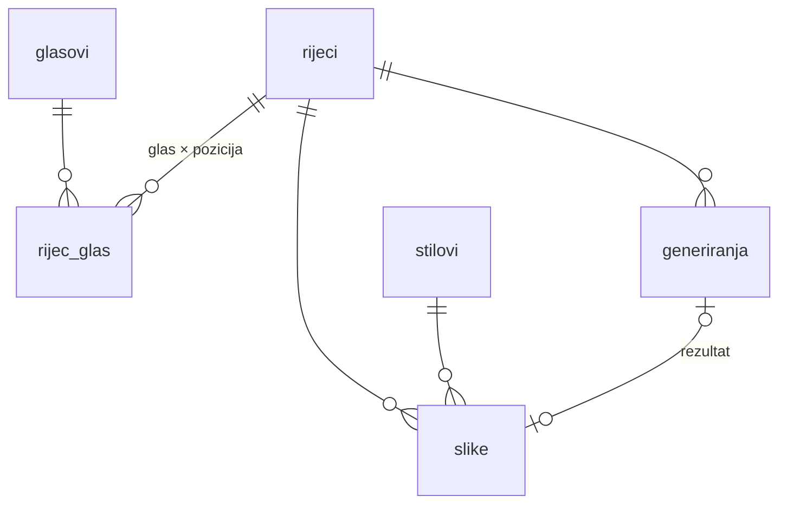
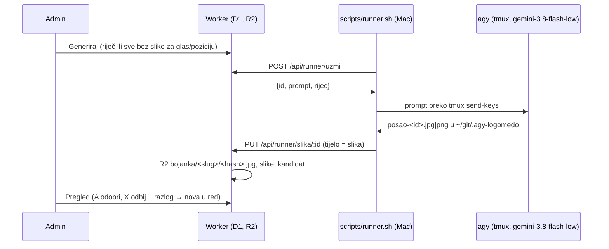

# Katalog slika po glasovima

## Model

- **`rijec_glas`**: riječ može biti pod više glasova i pozicija. KRASTAVAC je R skupina,
  S medijalna i C finalna. Stari app je imao jednu putanju po slici.
- **`potvrdeno`**: 1 = iz starog kataloga ili ga je potvrdio admin; 0 = izvedeno iz pravopisa
  (`src/lib/fonemi.ts`). Admin ih potvrđuje ili miče na stranici riječi.
- **`stilovi`**: zasad samo `bojanka`. Prompt je predložak s `{rijec}`, `{opis}` i `{napomena}`.
  Novi stil (npr. u boji) je novi redak, a slike se drže po riječi i stilu.
- **`slike.status`**: `kandidat` → `odobrena` | `odbijena`. Po riječi i stilu najviše je jedna
  odobrena (djelomični unique indeks). Razlog odbijanja ulazi u prompt sljedećeg generiranja
  („Avoid: …”).
- **`rijeci.opis_za_sliku`**: rješava homonime (luk, kosa, pas) i ide u prompt.

## Pozicije

Hrvatski pravopis je fonemski, pa `fonemi.ts` iz riječi izvodi glasove i pozicije. Dvoslovi
LJ, NJ i DŽ su jedan fonem (u LJULJAČKA nema L).

„Konsonantske skupine” postoje samo za R i znače **početnu** suglasničku skupinu: KR-, BR-,
SR-, uključujući slogotvorno R (CRV, BRDO). R u skupini usred riječi (TORBA, VATRA) je
medijalna. Tako je složen i stari katalog: pravilo se poklapa sa 629 od 632 starih putanja.
Preostale tri su legacy odluke ili greške (KRASTAVAC pod C-medijalno).

## Seed

`scripts/seed-katalog.ts` čita `../preuzimanje/data/catalog.csv` i daje `seed/katalog.sql`:
8 glasova, 428 riječi i 715 veza (614 iz starog kataloga, 101 izvedena). Stari nazivi
datoteka su očišćeni: „RAME (TIJELO)” postaje opis, a „BRESKVA (2)” i „SAPUN1” su ista riječ.

## Generiranje

- `agy` radi samo interaktivno, pa runner koristi tmux (isto kao `~/.claude/scripts/agy_glasovna.sh`).
  Gledanje: `tmux attach -t logomedo-agy -r`.
- Posao u stanju `radi` stariji od 15 min vraća se u red. Nakon 3 neuspjeha je `greska`,
  a na stranici Red ide natrag jednim klikom.
- Izmjereno 31. 10. 2026.: RAK, 177 s, JPEG 1024×1024, 220 kB, uredna bojanka iz prvog pokušaja.
  **Za cijeli katalog (428 riječi) to je oko 21 h jednim runnerom.** Više paralelnih runnera
  traži zasebne tmux sesije (`AGY_SESSION`, `AGY_DIR`). `uzmi` je atomaran, pa je to sigurno.
- Kvota: agy je na Google AI Pro pretplati, a ne na Claude kvoti.

## Javne slike (cdn.logomedo.com)

Dva R2 bucketa, isti ključ (`<stil>/<slug>/<16 hex sha256>.<ext>`):

| Bucket | Binding | Sadržaj | Pristup |
|---|---|---|---|
| `logomedo-slike` | `SLIKE` | sve: kandidati, odobrene, odbijene | privatno, admin `/admin/slika/:id` |
| `logomedo-javno` | `JAVNO` | **samo odobrene** | javno, R2 custom domena `cdn.logomedo.com` |

- `odluci()` (`src/lib/generiranje.ts`) nakon svake odluke zove `uskladiJavno()`: odobrena se kopira
  u javni bucket (`cache-control: public, max-age=31536000, immutable`), a slika koja prestane biti
  odobrena (odbijena, vraćena, istisnuta novom) briše se iz njega.
- Javni URL: `https://cdn.logomedo.com/<r2_kljuc>`; u adminu je link „javni URL” na stranici riječi.
  Listanje bucketa preko domene ne postoji, a ključ ima 64-bitni hash, pa se ne da pogoditi.
- Edge cache: zbog `immutable` povučena slika ostaje u cacheu dok se ne očisti. Purge radi samo ako
  postoji secret `CF_PURGE_TOKEN` (API token, Zone → Cache Purge, zona logomedo.com); bez njega
  Worker samo zapiše upozorenje u log.
- Slike odobrene prije uvođenja javnog bucketa (31. 10. 2026.) nisu kopirane same: ponovno ih odobri.
