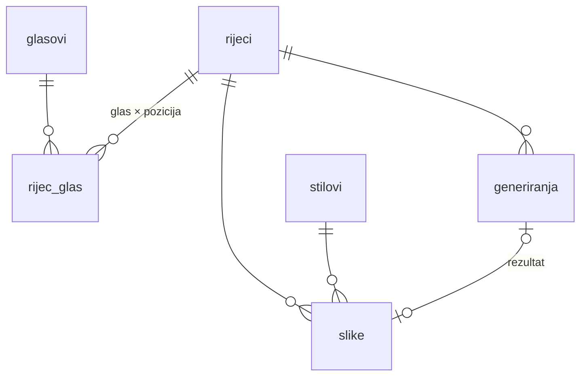
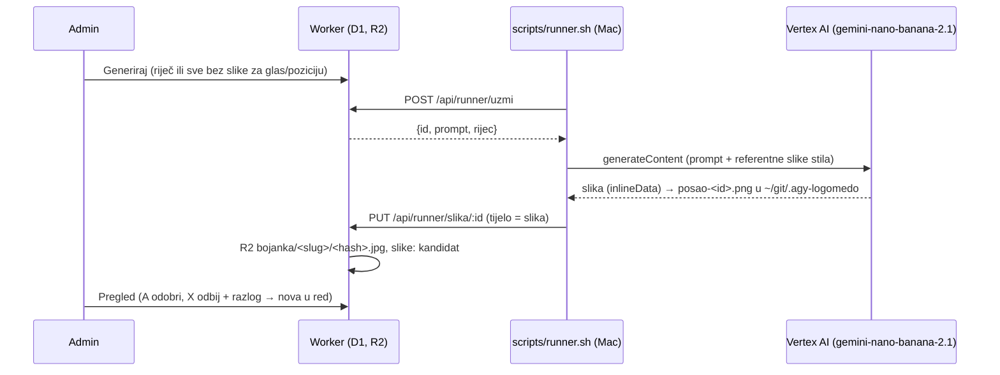

# Katalog slika po glasovima

## Model

- **`rijec_glas`**: riječ može biti pod više glasova i pozicija. KRASTAVAC je R skupina,
  S medijalna i C finalna. Stari app je imao jednu putanju po slici.
- **`potvrdeno`**: 1 = iz starog kataloga ili ga je potvrdio admin; 0 = izvedeno iz pravopisa
  (`src/lib/fonemi.ts`). Admin ih potvrđuje ili miče na stranici riječi.
- **`stilovi`**: zasad samo `bojanka`. Prompt je predložak s `{rijec}`, `{opis}` i `{napomena}`.
  Novi stil (npr. u boji) je novi redak, a slike se drže po riječi i stilu.
- **`slike.status`**: `kandidat` → `odobrena` | `odbijena`. Po riječi i stilu najviše je jedna
  odobrena (djelomični unique indeks). Razlog odbijanja ulazi u prompt sljedećeg generiranja
  („Avoid: …”).
- **`rijeci.opis_za_sliku`**: rješava homonime (luk, kosa, pas) i ide u prompt.

## Pozicije

Hrvatski pravopis je fonemski, pa `fonemi.ts` iz riječi izvodi glasove i pozicije. Dvoslovi
LJ, NJ i DŽ su jedan fonem (u LJULJAČKA nema L).

„Konsonantske skupine” postoje samo za R i znače **početnu** suglasničku skupinu: KR-, BR-,
SR-, uključujući slogotvorno R (CRV, BRDO). R u skupini usred riječi (TORBA, VATRA) je
medijalna. Tako je složen i stari katalog: pravilo se poklapa sa 629 od 632 starih putanja.
Preostale tri su legacy odluke ili greške (KRASTAVAC pod C-medijalno).

## Seed

`scripts/seed-katalog.ts` čita `../preuzimanje/data/catalog.csv` i daje `seed/katalog.sql`:
8 glasova, 428 riječi i 715 veza (614 iz starog kataloga, 101 izvedena). Stari nazivi
datoteka su očišćeni: „RAME (TIJELO)” postaje opis, a „BRESKVA (2)” i „SAPUN1” su ista riječ.

## Generiranje

- Od 2. 11. 2026. runner zove Vertex AI izravno (`scripts/vertex-slika.py`), vidi „Vertex AI na
  novom projektu” niže. Do tada je išao kroz agy u tmuxu; to je opisano u povijesnim odjeljcima.
- Posao u stanju `radi` stariji od 15 min vraća se u red. Nakon 3 neuspjeha je `greska`,
  a na stranici Red ide natrag jednim klikom.
- Izmjereno 31. 10. 2026.: RAK, 177 s, JPEG 1024×1024, 220 kB, uredna bojanka iz prvog pokušaja.
  (Bilo je preko agyja; Vertex treba ~12 s po slici.) `uzmi` je atomaran, pa je više
  paralelnih runnera sigurno.
- Trošak: Vertex se plaća s billinga projekta (ne Claude kvota, ne Google AI Pro).

### Prompt, sistemski prompt i pauza (`/admin/prompt`, 2. 11. 2026.)

- Konačni prompt = predložak stila (slaže se kad se riječ doda u red, `generiranja.prompt`) +
  **sistemski prompt** (postavka `sistemski_prompt`, dodaje se kad runner uzme posao, pa vrijedi i
  za poslove koji već čekaju). Snimak sistemskog ide u `generiranja.sistemski`, a u `slike.prompt`
  ide spojeni tekst. Migracija 0012 (`postavke`, `postavke_povijest`).
- Početni sistemski prompt zabranjuje lica na predmetima (Anita: smajlići na dimu, dimnjaku…).
  Uzrok je i predložak `ilustracija` („characters have gentle cheerful faces”).
- **Pauza / Nastavi**: dok je `red_pauza = 1`, `uzmi` vraća 204; slika u radu se završi. Nastavi zvoni runneru.
- Svaka izmjena (sistemski prompt, predložak, pauza) ide u `postavke_povijest`, vidljivo na stranici.
- `uzmi` prije svakog posla briše poslove za koje je nakon dodavanja nastala odobrena slika ili
  kandidat istog stila (zapis `generiranje.uklonjeno`, tko = `runner`). Povod: 110 poslova od 31. 10.
  čekalo je agyjev limit, a Anita je u međuvremenu ručno učitala dio slika (mašna je ipak dobila duplikat).

Zamke s deploya 2. 11.:
- `wrangler d1 migrations apply logomedo --remote` bez terminala ne primijeni migraciju (čeka
  „continue?”) i izlaz to ne pokazuje jasno. Kod je deployan bez tablice `postavke`, `uzmi` je
  vraćao 500 i runner je oko 1 min padao (launchd ga restarta). Uvijek `CI=1 npx wrangler d1
  migrations apply …` i provjeriti tablicu prije `wrangler deploy`.
- Promjene u `runner.sh` ne vrijede dok se launchd agent ne restarta (`scripts/launchd/instaliraj.sh`).

Od 2. 11. 2026. (migracija 0013) sistemski prompt i predlošci imaju **verzije** (`prompt_verzije`):
svaka izmjena s novim tekstom je nova verzija s bilješkom, posao pamti s kojom je verzijom nastao,
a `/admin/prompt` uz svaku verziju pokazuje odobreno/odbijeno i gumb „Aktiviraj” za povratak.
Postupak od recenzija do sljedeće verzije: `docs/prompt-iteracije.md`.

### Ručni upload (1. 11. 2026.)

Na stranici riječi, „Dodaj sliku iz vanjskog alata”: slika (PNG/JPEG/WebP, do 8 MB), stil,
alat/model (slobodan tekst, npr. „Gemini web”) i **obavezni prompt** kako je slika nastala.
Ulazi kao `kandidat` s `izvor = 'upload'` (`slike.model` = alat), dalje isti pregled i javni
bucket kao za agy. Isti R2 ključ (hash sadržaja) kao runner; ista datoteka dvaput se odbija.
SVG se za upload ne radi (potrace je samo u runneru).

### Nova riječ (1. 11. 2026.)

`/admin/nova-rijec` (gumb „Nova riječ” u Katalogu, ili „+ Dodaj …” u tražilici kad riječi nema).
Polja prate tablicu `rijeci`: riječ (samo hrvatska slova, razmak, crtica; do 40), opis za sliku,
primjer rečenice, rima. Glasovi i pozicije (`rijec_glas`) izvode se iz pravopisa dok se piše
(`fonemi.ts` u pregledniku); spremaju se samo označene, s `potvrdeno = 1`, a server ih izvodi
ponovno (ne vjeruje formi). Neobavezno odmah u red za generiranje po stilu. Postojeća aktivna
riječ preusmjerava na svoju stranicu; neaktivna se vraća s novim podacima. `izvor = 'admin'`.

### Brojke po stilu

Katalog i stranice glasova pokazuju jedan stil (prekidač, `?stil=ilustracija`; bez parametra
bojanka). Bočna traka broji sve stilove, pa pločice ispod broja pišu i „N u svim stilovima”.

### Tražilica

Polje u bočnoj traci admina (prečac `/`). `GET /admin/api/trazi` vrati sve aktivne riječi
jednom (na prvi fokus), filtrira se u pregledniku bez dijakritika (c = č/ć, dj = đ), prvo
riječi koje počinju upitom. Točka: zelena = odobrena slika, žuta = kandidat.

## Javne slike (cdn.logomedo.com)

Dva R2 bucketa, isti ključ (`<stil>/<slug>/<16 hex sha256>.<ext>`):

| Bucket | Binding | Sadržaj | Pristup |
|---|---|---|---|
| `logomedo-slike` | `SLIKE` | sve: kandidati, odobrene, odbijene | privatno, admin `/admin/slika/:id` |
| `logomedo-javno` | `JAVNO` | **samo odobrene** | javno, R2 custom domena `cdn.logomedo.com` |

- `odluci()` (`src/lib/generiranje.ts`) nakon svake odluke zove `uskladiJavno()`: odobrena se kopira
  u javni bucket (`cache-control: public, max-age=31536000, immutable`), a slika koja prestane biti
  odobrena (odbijena, vraćena, istisnuta novom) briše se iz njega.
- Javni URL: `https://cdn.logomedo.com/<r2_kljuc>`; u adminu je link „javni URL” na stranici riječi.
  Listanje bucketa preko domene ne postoji, a ključ ima 64-bitni hash, pa se ne da pogoditi.
- Edge cache: zbog `immutable` povučena slika ostaje u cacheu dok se ne očisti. Purge radi samo ako
  postoji secret `CF_PURGE_TOKEN` (API token, Zone → Cache Purge, zona logomedo.com); bez njega
  Worker samo zapiše upozorenje u log.
- Slike odobrene prije uvođenja javnog bucketa (31. 10. 2026.) nisu kopirane same: ponovno ih odobri.

## Runner u pozadini (launchd + push)

- `scripts/launchd/instaliraj.sh` instalira LaunchAgent `com.logomedo.runner` (`runner.sh --prod`,
  KeepAlive, ThrottleInterval 60 s). Log: `~/Library/Logs/logomedo-runner.log`.
  Uklanjanje: `instaliraj.sh --ukloni`. Restart nakon izmjene skripte: `launchctl kickstart -k gui/$(id -u)/com.logomedo.runner`.
- **Praćenje bez Claude sesije:** `scripts/runner-obavijesti.sh` (pokrenut s `nohup … &`) prati log i
  šalje macOS obavijest za svaku gotovu sliku, pauzu zbog kvote, grešku. Ne troši Claude kvotu
  (pravilo o tokenima: napredak se ne prati Monitorom u sesiji). Ne preživi restart Maca.
  Zaustavljanje: `pkill -f runner-obavijesti`.
- **Prioritet u redu** je samo `ORDER BY id`. Da posao ide naprijed/natrag, kopija s novim id-em pa
  brisanje starog (D1 ne dopušta `CREATE TEMP TABLE`: SQLITE_AUTH, a `--file` se tada vrati cijeli).
  Prompt se sprema pri dodavanju u red: nakon promjene predloška stila poslove koji čekaju treba prepisati.
- **Push umjesto pollinga.** Na praznom redu runner otvara WebSocket na `/api/runner/zvono`
  (`scripts/runner-cekaj.mjs`, bearer `RUNNER_TOKEN`). Durable Object `RunnerZvono`
  (`src/lib/runner-zvono.ts`, hibernacija, ping/pong bez buđenja) drži vezu; `dodajURed()` i
  „Vrati greške u red” zovu `zazvoni()`. Pri spajanju DO odmah zvoni ako nešto već čeka, a runner
  ionako provjerava red svakih 10 min. `/admin/red` pokazuje je li runner spojen.
- Zašto ne cloudflared tunel prema Macu: treba javni hostname + Access za lokalni servis i još jedan
  proces koji mora živjeti; WebSocket je izlazna veza s Maca, bez ičega otvorenog prema van.
- `src/worker.ts` je vlastiti ulaz (`main` u wrangler.jsonc): `/api/runner/zvono` ide mimo Astra
  (odgovor 101 s WebSocketom), sve ostalo `handle()` iz `@astrojs/cloudflare/handler`.

## SVG (vektorska bojanka)

agy daje samo 1024×1024 (alat ignorira zahtjev za veću rezoluciju; provjereno 31. 10. 2026. na 8
slika). Za ispis (A4 na 300 dpi ≈ 2480 px) runner nakon svake slike zove `scripts/svg.sh`:
ImageMagick prag 50 % → potrace → `PUT /api/runner/svg/:slika_id`. SVG ide u R2 pod istim ključem
s `.svg` (`slike.svg_kljuc`, migracija 0003), a za odobrene i u javni bucket. Tipično ~16 kB.
Worker odbija SVG sa `<script>`, `javascript:` ili `on*=` atributima.

## Kvota agyja (mjereno 31. 10. 2026.)

- Brzina nije usko grlo: 12 slika za redom, 40–53 s po slici (prosjek ~45 s).
- **Kvota alata za slike je.** Nakon 12–13 slika u danu agy javlja
  `429 RESOURCE_EXHAUSTED on gemini-3.1-flash-image` i reset za ~3–5 h (Google AI Pro, prozor
  Antigravityja). Katalog od 428 riječi preko agyja je zato pitanje dana, ne sati.
- Runner to prepoznaje (`KVOTA_RE` u `runner.sh`): posao ide natrag u red bez trošenja pokušaja
  (`POST /api/runner/odgodi/:id`), a runner spava do reseta pročitanog iz poruke
  („at HH:MM UTC” ili „in N hours and M minutes”, inače 30 min).
- Rezolucija je fiksno 1024×1024; zahtjev u promptu za 2K se ignorira (8 slika testirano).
- Otvoreno: Gemini API s plaćenim ključem (isti model, bez prozora, procjena ~$0,04/sliku,
  ≈ $17 za katalog; cijena nije provjerena) kao zamjena za agy pri masovnom generiranju.
  Ne automatizirati gemini.google.com preko preglednika.

### Noć 31. 10. → 1. 11. (izmjereno iz `~/Library/Logs/logomedo-runner.log`)

| Krug (lokalno) | Slike |
|---|---|
| 19:43–20:42 | 11 (#13–#23) |
| 00:43–00:52 | 12 (#39–#50) |
| 01:30 | 1 (#51, usred čekanja: prozor je vjerojatno klizni) |
| 05:33–05:51 | 10 (#52–#61) |

≈ 11–12 slika po krugu, krugovi ~5 h razmaka. Ujutro 1. 11. u redu 118 poslova
(103 ilustracije, 15 bojanki) → ~10 krugova, procjena kraja 3. 11. oko 8 h.

Zamka (popravljeno 7c7fe18): agy je napisao reset sa sekundama (`00:41:30 UTC`), stari regex
je „41” pročitao kao sat i Python se srušio; runner je pao, a launchd ga je ponovno pokrenuo.

### Tjedna kvota: 1. 11. 2026. (procjena za 3. 11. ne vrijedi)

Osim kliznog prozora od ~5 h postoji i **tjedna** kvota na alatu za slike. Dan 1. 11.:
#62–#67 u 10:43–10:51, #68–#69 u 11:24, zatim #70 (dim) osam puta 429. U 15:13 agy je
napisao „Model quota will reset after ~143 hours”, a runner je to pročitao i otišao spavati
8582 min. Ukupno 69 poslova je gotovo, ~102 je ostalo u redu (#70–#171).

Provjereno 2. 11. u 06:37 ručnim promptom (jabuka). `gemini-3.8-flash-low` daje
`429 … gemini-3.1-flash-image … reset 2026-11-07T13:41:03Z`, a `gemini-4-argon-low` daje
„reset after 128h”, dakle isti termin. **Promjena glavnog modela ne pomaže**: svaki od njih
pokrene podagenta s istim modelom za slike, a kvota je po Google računu. Prije 14:41
7. 11. (lokalno) pomaže samo drugi Google račun u agyju ili Gemini API s plaćenim ključem.
Ovim tempom (~70 slika pa tjedan pauze) red ne završava u razumnom roku.

### Vertex AI na `bimbo-sync-prod`: blokiran (provjereno 1. 11. 2026.)

Ideja je bila prenijeti `lib/vertex_auth.js` iz `~/git/domovinatv/fetch.domovina.tv`. Svaki
poziv (tekst `gemini-3.8-flash`, slika `gemini-2.5-flash-image`, global i us-central1) vraća
`403 Request rejected in accordance with our terms of use and policies`, isto kao u fetchu od
28. 10. Billing je uključen, krediti $123,01 od $300 (vrijede do 14. 12. 2026.), račun je još
free trial. Nije rate-limit ni nedostatak kredita. Matija je odustao od toga puta; novi projekt
na istom billingu samo da se zaobiđe blokada ne raditi. Ručni upload (gore) pokriva slike
iz vanjskih alata.

### Vertex AI na novom projektu: radi (2. 11. 2026.)

- Projekt `project-80b5a036-aed8-4b40-bd2`, billing `01FCCE…` (ne blokirani `01FAEA…`),
  Google račun je u `VERTEX_ACCOUNT` (`.env.production`/`.dev.vars`, gitignored), Owner, gcloud konfiguracija `logomedo`.
  Globalna `default` konfiguracija ostaje na drugom računu; runner traži token s
  `gcloud auth print-access-token --account=…` (`VERTEX_ACCOUNT`), pa ne ovisi o aktivnom računu.
- Model `gemini-nano-banana-2.1` (Nano Banana 2.1, GA 6. 10. 2026., nasljednik `gemini-3.1-flash-image`;
  na projektu su još `gemini-3.1-flash-lite-image` i `gemini-3-pro-image`; `…-3.8-…-image` ne postoji), lokacija `global`, `thinkingLevel: LOW`, `aspectRatio: 1:1`.
  Prva slika: ~12 s, 1.120 izlaznih tokena za sliku + ~600 tokena razmišljanja.
  `gemini-3.1-flash` ne postoji (404); tekstni je `gemini-3.1-flash-lite`.
- Prvih ~15 min nakon dodjele Ownera svaki poziv je vraćao `403 aiplatform.endpoints.predict`
  (propagacija IAM-a), a ne blokadu.
- `vertex-slika.py`: 429 i 5xx → izlaz 2/3, runner posao vraća u red (`odgodi`) i čeka
  60 s, udvostručeno do 30 min. Blokada sadržaja ili odgovor bez slike → `greska` (troši pokušaj).
- Runner šalje `X-Model`, pa `slike.model` bilježi model koji je stvarno nacrtao sliku
  (prije je bio default stila, `gemini-3.8-flash-low`, što je glavni model agyja; slike je crtao
  njegov alat `gemini-3.1-flash-image`, pa su stari zapisi 2. 11. ispravljeni na to). `slike.izvor` ostaje `agy` (CHECK u
  shemi); to znači „runner”.
- Matija ne želi AI Studio ni Vertex Studio u konzoli, samo API.
- Alternative (fal.ai, OpenRouter, Gemini Batch), cijene i besplatni krediti:
  [2026-11-02-nano-banana-servisi.md](2026-11-02-nano-banana-servisi.md).

## Plan: stilovi, dodaci, referentne slike (dogovoreno 31. 10. 2026., nije napravljeno)

- **Stil** (jedan): `bojanka` (SVG) i novi `ilustracija` (raster u boji); `stilovi.vektor`.
- **Dodaci** u skupinama (kao Adobe Firefly): unutar skupine jedan, skupine se kombiniraju
  (npr. Pozadina: bez; Pogled: sprijeda/profil; Lice: veselo; Boje: pastelne/jarke). Tablica
  `dodaci`, odabir spremljen u `generiranja.dodaci`, živi pregled cijelog prompta u adminu.
  Stil može imati zadane dodatke („blueprint”). Primjer potrebe: astronaut je dobio mjesec,
  raketu i zvjezdice; „bez pozadine” to rješava.
- **Referentne slike stila (31. 10. 2026., uvedeno za `ilustracija`)**: runner za stil X traži
  `~/git/.agy-logomedo/stil/X/*.jpg|png` (lokalno, nije u repou) i kaže agyju da ih da alatu kao
  uzor samo za stil. Za ilustraciju su to tri izreza iz božićne abecede napravljene u Geminiju
  (džemper, đumbirko, rukavice); prompt stila je prepisan prema njoj (migracija 0007).
  Prvih nekoliko ilustracija treba usporediti s uzorom prije cijelog kataloga.
- **Prvo test referentnih slika**: runner agyju da 2–3 odobrene slike stila kao style reference
  (kao Midjourney `--sref`, Leonardo Image Guidance), za dosljednost 428 slika. Provjeriti na
  2–3 riječi prije gradnje UI-ja. Odobrena je zasad samo zebra.

## Ručni test: Gemini web i Leonardo (31. 10. 2026.)

Dok je agy čekao reset kvote, poslovi #13 (brisači) i #14 (crijep) ručno su generirani u
pregledniku (Claude in Chrome, Brave): #13 u gemini.google.com (Flash-Lite, 1024×1024),
#14 u Leonardo webu (Lucid Origin, Dynamic, free plan, ~136 tokena ostalo).

- **Hrvatska riječ u promptu je glavni uzrok promašaja, ne alat.** S promptom iz reda
  doslovno: Gemini je „BRISAČI” nacrtao kao gumicu za brisanje, Leonardo je „CRIJEP”
  nacrtao kao *tekst* „crijep”. S engleskim pojmom („car windshield wipers”, „clay roof
  tile”) oba su pogodila iz prvog puta.
  → Otvoreno: polje `engleski` u katalogu (jednom popuniti za 632 riječi) i prompt
  „BRISAČI (car windshield wipers)”. Vjerojatno smanjuje odbijanja više od promjene alata.
- Izvlačenje slike: Leonardo slike su javne na `cdn.leonardo.ai/...jpg` (curl bez kolačića,
  makni `?w=`). Gemini daje `blob:`; `fetch(blob)` pada, canvas `toDataURL` radi, ali slanje
  na `http://127.0.0.1` iz stranice blokira CSP, a base64 kroz alat je ~100k tokena.
  Ostaje gumb za preuzimanje (→ `~/Downloads`).
- **Odluka: Gemini web se ne automatizira skriptom** (Playwright + Brave profil). Google
  uvjeti zabranjuju automatizirani pristup, a račun je glavni (Gmail, Drive, Pro); jedan
  billing account već je flagiran. Web vjerojatno troši istu Pro kvotu za slike kao agy
  (nije provjereno). Leonardo web isto ne: ima službeni API (krediti odvojeni od web plana,
  cijena nije provjerena).
- Preporučeni put: Gemini API s plaćenim ključem kao backend u `runner.sh` (vidi Kvota
  agyja), po želji Leonardo API kao drugi backend.
- #13 i #14 nisu poslani na produkciju; vratili su se u red nakon 15 min (`radi` → red).

## Pregled s više admina (31. 10. 2026.)

Zamka koja je stvarala slike „u krug”: astronaut je imao dva kandidata; Anita je odobrila
jednog, drugog odbila s „Imam drugog”, a kvačica „Generiraj novu” bila je uvijek uključena, pa
je za 50 s stigao novi kandidat. Sada:

- „Odbij” traži novu sliku samo ako riječ nema odobrenu ni drugog kandidata u tom stilu;
  u pregledu je kvačica tada isključena („riječ već ima odobrenu”).
- Odobri/odbij su uvjetni UPDATE (`status = 'kandidat'`): pamti se prva odluka, kasnija dobiva
  409 s time tko je bio brži (`odluci()` u `src/lib/generiranje.ts`).
- Pregled se svake 3 s usklađuje preko `GET /admin/api/kandidati`: tuđe odluke nestaju s
  ekrana, novi kandidati dolaze na kraj. Nije WebSocket; kašnjenje do 3 s, ispravnost jamči server.
- Lokalni test s dvije sesije: odobri kod jednog → drugome nestane uz poruku; istovremeni
  „Odbij” obaju → jedna odluka, nijedan novi posao u redu.
