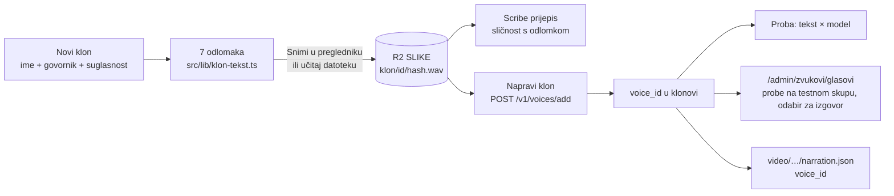

# Klon glasa (ElevenLabs), /admin/zvukovi/klonovi

Od 24. 11. 2026. Superadmin od vlastitih snimki napravi ElevenLabs glas koji zatim izgovara riječi, upute i
naraciju videa. Cilj: svaki logoped jednog dana ima svoj glas, pa ista vježba ima njegovu naraciju.

## Što je na stranici

- **Tekst za čitanje:** 7 odlomaka, ~2 min, u tonovima koje klon treba (pozdrav, upute djetetu, pohvala, priča,
  brojanje, naracija, završetak). Zajedno pokrivaju svih 30 glasova i parove Č/Ć, DŽ/Đ, LJ/NJ, IJE (test).
- **Snimanje:** bez obrade preglednika (echo/noise/AGC isključeni: ElevenLabs želi sirov glas), obrezani rubovi
  tišine (250 ms rezerve), vrh na −3 dBFS, mono WAV u izvornoj frekvenciji. Traka razine tijekom snimanja.
- **Mjerenja** (`upozorenja()`): trajanje ≥ 5 s, izobličenje, RMS −26…−15 dB (cilj −23…−18), šum u tišini
  ≤ −50 dB, pauza ≤ 1,5 s. Scribe prijepis i sličnost s odlomkom (≥ 90 % zeleno).
- **Novija snimka odlomka** isključi stariju („u klonu”), stara ostaje za usporedbu.
- **Dodatne snimke:** gotove datoteke (WAV, MP3, M4A, OGG, FLAC, do 20 MB).
- **Napravi klon:** uključene snimke idu u ElevenLabs; ponovna izrada napravi novi glas i obriše stari.
  „Ukloni pozadinski šum” samo za snimke koje šume (ElevenLabs: na čistima zna pokvariti glas).
- **Proba:** tekst do 1000 znakova × model (`eleven_v4`, `eleven_multilingual_v2`, `eleven_v3`), mp3 u R2
  (`klon/<id>/proba/<hash>.mp3`), isti tekst i model se ne plaća dvaput.
- **Brisanje** (povučena suglasnost): glas na ElevenLabsu, snimke i probe u R2; redak ostaje kao trag.
- Klon je običan glas računa, pa se sam pojavi na **Glas koji čita** (oznaka „kloniran”), gdje prolazi isti
  testni skup kao ostali glasovi i može postati glas izgovora.

Samo superadmin (`lib/admin/rute.ts`: `/admin/zvukovi/klonovi`, `/admin/api/klon`). Tablice: `migrations/0043_klonovi.sql`.

## ElevenLabs: Instant i Professional

Stanje računa 24. 11. 2026.: plan **Starter** (40 000 znakova/mjesec, 10 glasova), ključ ima sve dozvole
(`voices_write`, `user_read`). Starter ima samo Instant klon.

| | Instant (IVC) | Professional (PVC) |
|---|---|---|
| Snimke | 1–2 min, ne više od 3 | 30 min minimum, idealno 2–3 h (dijelovi po ~30 min) |
| Izrada | sekunde, kroz API | trening 3–6 h (do 24 h), verifikacija glasa |
| Plan | Starter ✓ | Creator ($22/mj) i više, 1 PVC mjesto |
| Čiji glas | govornik uz suglasnost | **samo svoj**, ni sa suglasnošću tuđi |
| Kvaliteta | dobra za naraciju, slabija na rijetkim glasovima | gotovo neprepoznatljiv od izvornika; `eleven_v4` ga podržava |

Preporuke ElevenLabsa za snimanje (oba): tiha soba bez jeke, mikrofon na dvije šake s pop-filtrom, RMS −23 do
−18 dB, vrh −3 dB, jedan govornik, isti stil cijelo vrijeme (klon kopira tempo, disanje i pauze), MP3 ≥ 128 kbps
ili WAV. API ne bilježi suglasnost, zato je u `klonovi.suglasnost` (doslovni tekst izjave i vrijeme).

## Prvi pokus: naracija demo videa

1. `/admin/zvukovi/klonovi` → novi klon → pročitaj 7 odlomaka → „Napravi klon” → proba na rečenicama videa.
2. `video/01-uvod/narration.json`: `voice_id` na klonov (vidi se na stranici klona); po potrebi `model_id`.
3. `node video/scripts/tts-elevenlabs.mjs video/01-uvod --force all` (≈ 800 znakova), pa `build-root.mjs`
   i render kao `renders/logomedo-uvod-v2.mp4` (`video/README.md`). Scene se same prilagode novim vremenima.

## Kasnije: glas po logopedu

Nije napravljeno. Ideja: `korisnici.glas_id` (klon logopeda), a izgovor bilježnice/zadatka kojeg je logoped
autor ide njegovim glasom; ključ snimke u `zvukovi` tada mora uključiti glas (danas je samo tekst). Trošak:
bilježnica ~600 znakova po glasu, Starter ima 40 000/mj, pa za više logopeda treba veći plan. PVC je samo
za vlastiti glas, pa ga svaki logoped mora napraviti sam (sa svojim snimkama, na našem računu).
