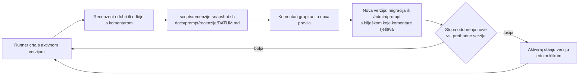

# Iteracije prompta: od recenzija do sljedeće verzije

Cilj: sistemski prompt i predlošci stilova konvergiraju prema verziji kod koje recenzent
(human-in-the-loop, pregled na `/admin/pregled`) odbija što manje slika. Svaka recenzija je
oznaka klasifikatora „dobra / loša slika”, a komentar uz odbijenu sliku je razlog.

## Petlja

1. **Snimak.** `scripts/recenzije-snapshot.sh [od-datuma]` čita produkcijski D1 i piše
   `docs/prompt/recenzije/<danas>.md`: stopu odobrenja po (stil, verzija sistemskog prompta, verzija
   predloška), svaku odbijenu sliku s komentarom i verzijama s kojima je nastala, i tekst svih verzija.
   Snimak se commita; repo je javan, pa u njemu nema e-maila ni imena recenzenta.
2. **Analiza.** Komentar se ne prepisuje u prompt doslovno. Pitanje je: koje *opće* pravilo bi
   spriječilo ovu i slične greške na drugim riječima? Primjedba vezana samo uz jednu riječ
   (dim: „krov se ne vidi”) ne ide u sistemski prompt: ona već ide u napomenu sljedećeg posla te
   riječi (`Avoid: <komentar>` u `sloziPrompt`, zadnja tri razloga), a trajno u `rijeci.opis_za_sliku`.
3. **Nova verzija.** Na `/admin/prompt` „Spremi kao novu verziju” s bilješkom, ili migracija kad je
   izmjena velika (primjer: `migrations/0014_prompt_v4.sql`). Bilješka navodi koje komentare
   pravilo pokriva, da se sljedeći snimak može čitati protiv nje.
4. **Mjerenje.** Svaki posao pamti `sistemski_verzija` (kad ga runner uzme) i `predlozak_verzija`
   (kad je dodan). `/admin/prompt` uz svaku verziju pokazuje odobreno / odbijeno / čeka i postotak.
   Usporediti tek kad nova verzija ima bar ~20 pregledanih slika; riječi nisu jednako teške.
5. **Povratak.** „Aktiviraj” na bilo kojoj starijoj verziji odmah je vraća (sistemski prompt vrijedi
   i za poslove koji već čekaju; predložak samo za nove poslove). Ništa se ne briše.

## Pravila sistemskog prompta v4 i komentari iz kojih su nastala

Snimak: `docs/prompt/recenzije/2026-11-02.md` (29 komentara na 33 odbijene slike od 144 pregledane).

| Pravilo | Komentari |
|---|---|
| 1 lica samo na ljudima i životinjama | dim, fritule, grana, hlače, led, lizalica, cvijet („ne stavljaj smajliće na stvari”) |
| 2 realizam: oblik, boje, anatomija | pahuljica (bijela, bez šarenih ukrasa), sova (bez satenskih krila), sob (pravi rogovi, razlika od jelena), grana bora (bez bobica), traktor (crni kotači), lizalica (crveno-bijela) |
| 3 ništa suvišno, bez natpisa | led (šal), iglu (dim i ukrasi), traktor (vozač), čaj (natpis na šalici) |
| 4 fokus na pojmu | zvono (ovjes manji, na vrhu) |
| 5 parovi jednaki | skije, šal (uzorak na oba kraja) |
| 6 volumen | poklon (kocka), kolač (oblik kocke) |
| 7 broj prema riječi | kuglice/kuglica, ukrasi (raznolikost), ljudi (puno, različite dobi), trag (manje i veći) |
| 8 značenje koje dijete zna | brisači (na vjetrobranu), crijep (krov s crijepom), koš (košarkaški), bal (dvorana s parovima) |

Predlošci v2 (ilustracija, bojanka) uz to miču vlastite proturječnosti: „characters have gentle
cheerful faces” i „small charming decorative details” (izvor smajlića i ukrasa), „Exactly one” (sukob s
množinom) i strogo „no scene” (sukob s brisačima i balom). Poslovi koji su čekali u redu prepisani su
na v2 u istoj migraciji.

Komentari bez općeg pravila (ostaju na razini riječi): astronaut „imam drugog”, dim „krov se ne
vidi”, čaj (vrećica na špagici), kolač (puslica od šlaga), cvijet (božićna zvijezda).

## Otvoreno

- Referentne slike stila (`~/git/.agy-logomedo/stil/ilustracija/`: džemper, đumbirko, rukavice) su
  božićne i nose uzorke i odjeću na slike, protivno pravilu 3. Zamijeniti ih neutralnim odobrenim
  slikama (npr. lizalica, traktor, siga) kad v4 pokaže rezultat; reference nisu verzionirane u bazi,
  pa promjenu zapisati u bilješku sljedeće verzije.
- Četiri odbijene slike nemaju komentar (astronaut, snijeg, mašna, medenjak): duplikati ili ručne zamjene.
