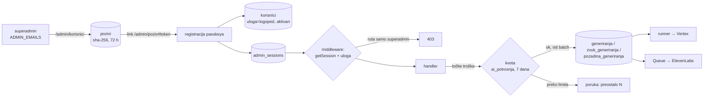

# Plan: logopedi u adminu (RBAC, pozivnica, AI kvota)

Plan od 16. 11. 2026. (sesija S0). Lanac sesija: [handoffs/README.md](handoffs/README.md).

## Zašto

Admin danas poznaje samo jednu ulogu: e-mail u secretu `ADMIN_EMAILS`, prijava kroz Cloudflare
Access ili passkey. Želimo uključiti druge logopede (prvo dva alpha testera) koji isprobavaju cijelo
admin sučelje i grade katalog. Pritom administracija mora ostati izolirana, a pozivi prema Vertex AI
i ElevenLabsu ograničeni kvotom. Access politika za N korisnika koji nastaju dinamički nema smisla,
pa logoped ulazi jednokratnom pozivnicom i svojim passkeyem.

## Arhitektura

| Uloga | Izvor | Katalog | Zadaci, bilježnice | AI | Administracija |
|---|---|---|---|---|---|
| superadmin | secret `ADMIN_EMAILS` | sve | sve | bez limita | sve |
| logoped | `korisnici` (`uloga='logoped'`, `aktivan=1`) | sve (autor se prati) | samo svoje | kvota 7 dana | ništa |

Administracija = `prompt`, `red`, `korisnici`, `zvukovi/glasovi` i `api/zvuk-proba` (izbor i probe
glasova), `app/prijava` i `/api/v1` (aplikacija), tuđi zapisi u Aktivnosti.

## Tvrdi uvjeti (svaka sesija)

- Superadmina definira samo `ADMIN_EMAILS`. Ništa u bazi ne može dati superadmina ni ga oduzeti.
- Pozivnica se nikad ne izdaje za e-mail iz `ADMIN_EMAILS`.
- Provjera troška je u funkcijama kroz koje svaki posao mora proći, ne samo u UI-ju ili na ruti.
- Repo je javan: u njemu nema e-mailova, imena testera, tokena ni linkova pozivnica.
- Sigurnosnu logiku (`src/lib/admin/*`, `src/middleware.ts`) mijenjati svjesno: komentar „iz omm”
  dopuniti razlikom (uloge), ne kopirati natrag u omm bez odluke.
- Ništa ne ide na produkciju prije S5 i korisnikovog „go”.
- Prije commita: `npm test && npm run check && npm run build`.

## Sesije

| # | Faza | Paket | Odluke | Gotovo kad |
|---|---|---|---|---|
| S1 | F0 | Harness `node:sqlite`, migracija 0032, `ovlasti.ts`, uloga u sesiji i passkey prijavi | 100–199 | testovi zeleni (> 111, skipped 0), `check` i `build` zeleni; test dokazuje da logoped dobije sesiju, deaktiviran ne, `admin` redak izvan `ADMIN_EMAILS` ne |
| S2 | F1 | Pozivnica, `/admin/poziv`, `/admin/korisnici`, zapisi u aktivnosti | 200–299 | testovi pozivnice (istekla, potrošena, superadmin e-mail, dvostruka upotreba) zeleni; lokalni e2e skripta s virtualnim autentifikatorom prolazi |
| S3 | F2 | Rute samo za superadmina, vlasništvo zadataka i bilježnica, Aktivnost po korisniku, UI po ulozi | 300–399 | testovi matrice ruta zeleni; e2e kao logoped: zabranjene rute 403, tuđi zadatak 404 |
| S4 | F3 | AI kvota na svim točkama troška, `rijeci.dodao`, pregled po korisniku | 400–499 | `node:sqlite` testovi: granica limita i istovremeni zahtjevi; `grep` ne nalazi točku troška bez kvote; e2e: logoped s limitom 1 dobije poruku na drugom zahtjevu |
| S5 | F4 | Code review, `docs/admin.md`, **vrata**: migracija i deploy, pozivnice testerima | 500–599 | `/code-review high` bez otvorenih nalaza; produkcija: superadmin prijava radi, testeri su se prijavili passkeyem |

Procjena: 5 sesija, bez paralelnih (svaka dira `middleware.ts` ili `src/lib/admin/`). Vrata su u S5
(produkcija i slanje linkova). Najrizičniji paketi:

- **S1**: mijenja `getSession`, kroz koji prolazi svaki admin zahtjev. Greška zaključa superadmina ili
  pusti nekoga tko ne smije. Zato prvo harness i testovi.
- **S4**: kvota mora biti atomska i ne smije propustiti nijednu točku troška (ima ih 9, plus
  `/api/v1/admin/slike/*` s `ponovi`).

Prvi stvarni trošak (Vertex, ElevenLabs) može nastati tek u S4 lokalnim e2e testom, i to samo ako
lokalni runner ili queue stvarno rade; e2e kvote provjerava upis u red, ne generiranje.

## Gdje smo

S0 (16. 11. 2026.): plan, koda nema.
S1 (16. 11. 2026.): harness, 0032, ovlasti, uloga u sesiji i passkey prijavi (d10369e, 153 testa).
S2 (16. 11. 2026.): pozivnica, `/admin/korisnici`, 0033, e2e s virtualnim autentifikatorom (b46c02f, 176 testova). Sljedeće: S3.
