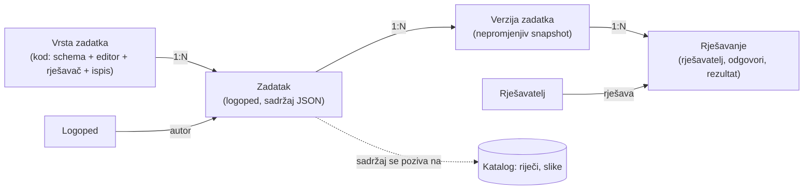

# Zadaci: predlošci, instance, rješavanja

Status (2026-11-07): vrsta `prvi_glas` (kolo slova, izdvajanje prvog glasa) i teme boja kola na produkciji
(migracija 0022, deploy 827268e0; Time Travel bookmark prije migracije `00000316-00000000-0000511c-2e2ec4f124f229bf0fb1ae028f8363fc`).
Provjereno u Braveu na produkciji: zadatak 43 (editor, „Dijete rješava”, Ispis, PDF složen bez preuzimanja) i probna javna
bilježnica `/b/proba-kolo-slova` (id 6, još postoji: obrisati ili zadržati za Anitu). Zvuk i uspravni prikaz na produkciji nisu provjereni.
Status (2026-11-02, navečer): vrsta `percepcija` (vizualna percepcija: pronađi različitu / dvije iste) na produkciji
(migracija 0016, deploy 6fbc6ea3; Time Travel bookmark prije migracije `0000008a-00000182-00005117-78b34e56455b0d3413ecebd7a5cb87ee`).
Na produkciji još nema nijednog zadatka te vrste.
Status (2026-11-02, kasnije): Flutter aplikacija igra scene i bilježnice (`/api/v1/admin/biljeznice`, `/zadaci`; ostale vrste u aplikaciji još nemaju renderer).
Status (2026-11-02): vrsta `scena` i pozadine na produkciji (migracija 0010, deploy 2. 11.); na produkciji još nema nijedne pozadine.
Status (2026-10-31): baza (`migrations/0004_zadaci.sql`) i admin za sve četiri vrste su na produkciji
(`/admin/predlosci` za novi zadatak iz vrste, `/admin/zadaci` za gotove zadatke s mekim brisanjem i vraćanjem): editor, pregled „Dijete rješava” i A4 ispis. Djeca i spremanje rješavanja još nemaju UI. Vrste zadataka se dopisuju
u odjeljak „Vrste zadataka” kako ih Matija opisuje.

## Opseg (odluka 2026-10-31)

Ova aplikacija je **samo admin**: izrada strukture sadržaja (katalog, vrste zadataka, zadaci).
Aplikacije za krajnje korisnike (logopedi, djeca) bit će zasebni frontendi koji čitaju isti
sadržaj preko API-ja. Zato se pitanja tko rješava, uvoz starih korisnika i prijava logopeda
odgađaju do prvog takvog frontenda. Model ih i dalje predviđa (`autor_id`, `rjesavanja`), ali se
sada ne grade.

Analiza starih listića i koji su podaci kvalitetni: `../preuzimanje/docs/legacy-kvaliteta.md`.

## Pojmovi

| Pojam | Što je | Tko ga stvara |
|---|---|---|
| **Vrsta zadatka** (predložak) | Tip zadatka: kakav sadržaj prima, kako se uređuje, rješava, ispisuje i boduje | developer, u kodu |
| **Zadatak** (instanca) | Jedna vrsta + konkretan sadržaj (riječi, slike, rečenice, naslov). Stari radni listić je jedna instanca vrste `listic` | logoped |
| **Rješavanje** | Jedan pokušaj jednog rješavatelja na jednoj verziji zadatka: odgovori, rezultat, vrijeme | rješavatelj |



## Odluke u modelu

1. **Vrsta zadatka živi u kodu, ne u bazi.** Svaka vrsta treba vlastiti editor, rješavač i
   ispis, pa je to TS modul (`src/zadaci/<kod>/`): `schema` (zod) za sadržaj, `Editor`,
   `Rjesavac`, `Ispis` (PDF/print) i `ocijeni(sadrzaj, odgovori)`. U bazi je samo `kod`.
2. **Sadržaj instance je JSON** validiran schemom vrste. Slike i riječi se referenciraju po
   `rijec_id` / `slika_id` iz kataloga, ne kopiraju; vlastiti tekst (rečenica umjesto naslova
   kartice) ide u JSON.
3. **Verzije.** Kad logoped uredi zadatak koji je već netko rješavao, nastaje nova verzija;
   rješavanja ostaju vezana uz verziju koju su vidjela. Inače bi stari rezultati značili nešto drugo.
4. **Listić = zadatak.** Stari listić (naslov + kartice slika/riječ) je vrsta `listic`; ispis
   kao danas, a rješavanje je opcionalno (vrsta može biti samo za ispis).
5. **Multiuser.** Svaki zadatak ima `autor_id`; vidljivost `privatno | dijeljeno | javno`
   (javno = drugi logopedi mogu kopirati u svoje, s `izvor_id`).
6. **Prijava logopeda nije Cloudflare Access.** Access ostaje za admin. Logopedi: e-mail
   (magic link / OTP) + passkey, ista mehanika kao admin sesije, zasebne tablice.
7. **Dijete nema račun (odluka 2026-10-31).** Zadatke uvijek ispunjava dijete s logopedom, na
   logopedovom uređaju, u logopedovoj sesiji. Logoped vodi svoju bazu djece; svako rješavanje
   bilježi koje dijete, koji zadatak (i verziju) i kada, pa se po djetetu vidi kronologija.
   Dijete pripada jednom logopedu i drugi logopedi ga ne vide. O djetetu se čuva minimum
   (nadimak ili šifra koju logoped razumije, godina rođenja, napomena), ne puno ime ni OIB:
   to su podaci o zdravlju maloljetnika (GDPR čl. 9).

## Implementacija

| Što | Gdje |
|---|---|
| Tablice | `migrations/0004_zadaci.sql` |
| Vrste: normalizacija, provjere, ocjena, generator | `src/lib/zadaci/vrste.ts` (+ test) |
| Ključ rime, slogovi | `src/lib/zadaci/rima.ts` (+ test) |
| Upiti, verzije | `src/lib/zadaci/baza.ts` |
| Editor, „Dijete rješava”, A4 ispis (DOM u pregledniku) | `src/lib/zadaci/klijent.ts`, `src/pages/admin/zadaci/[id].astro` |
| PDF za ispis (u pregledniku, pdf-lib + fontkit) | `src/lib/pdf/`: `model.ts` (stranice), `ispis-pdf.ts` (crtanje, + test), `svg.ts` (bor i grančice kao vektor), `preglednik.ts` (fontovi, slike, preuzimanje); slike s CDN-a kroz `/cdn/<ključ>` (`src/pages/cdn/[...kljuc].ts`) |
| API | `POST /admin/api/zadatak` (novi), `POST /admin/api/zadatak/:id` (JSON spremi, form obriši), `POST /admin/api/rijeci` (nova riječ) |

**PDF.** Glavni ispis je „Preuzmi PDF” (pogled Ispis u editoru i `/b/<slug>/ispis`), kao u starom
LogoMedu (pdfmake). PDF se slaže u pregledniku: Nunito 800/900 iz `public/fonts/` kao podskup (hrvatska
slova), slike smanjene na ≤ 800 px JPEG (PDF bilježnice ~1–2 MB, ne 6 MB), raspored kao HTML ispis
(odabir 3 reda, uljez 4, povezivanje 1 stranica, listić 3 × 4). Slike idu kroz `/cdn/` jer
cdn.logomedo.com nema CORS, a CSP stranice dopušta `connect-src 'self'`. „Ispiši” (dijalog preglednika)
ostaje kao sporedni gumb.

Izmjereno na produkciji 1. 11. 2026. (Božićna rima, 6 stranica, 14 slika): 1009 KB, ~1,5 s od klika.
Bez smanjivanja slika isti PDF ima 5,8 MB. Zamke: u `drawSvgPath` pdf-lib skalira i debljinu crte i
crtkanje (pišu se u SVG jedinicama, ne u točkama); `color` bez `borderWidth` samo puni, bez obruba. U
lokalnom devu prvi `import()` pdf-lib-a zna izazvati Vite reload stranice (optimizacija ovisnosti).
Gumb u admin editoru nije isproban u pregledniku (prijava passkeyem), dijeli kod s javnim ispisom.

U editoru se slika bira iz cijelog kataloga (pretraga po riječi ili `-rima`, filtri „rimuje se / ne rimuje
se s …”); riječ koje nema može se odmah dodati u katalog (bez glasa), a slika joj se generira na
stranici riječi. Dok riječ nema sliku, prikazuje se riječ.

Stil slika je po zadatku (`zadaci.stil`, zadano `ilustracija`, migracija 0018), izbor „Slike” u
ploči editora. Redoslijed: odobrena u stilu zadatka, odobrena u drugom stilu, kandidat u stilu,
bilo koji kandidat (`slikaUStilu`). Vrijedi za editor, ispis i `/api/v1/admin/zadaci/{id}`; u
bilježnici vrijedi stil bilježnice. Prije (do 3. 11. 2026.) editor je uzimao zadnju sliku bez obzira
na stil, pa je npr. SNJEGOVIĆ bio bojanka iako ima odobrenu ilustraciju.

## Skica tablica (D1)

```sql
korisnici        (id, email UNIQUE, ime, uloga 'logoped'|'admin', legacy_uid, created_at)
zadaci           (id, autor_id, vrsta, naslov, vidljivost, izvor_id, aktivna_verzija, created_at, updated_at, obrisan_at)
zadatak_verzije  (zadatak_id, verzija, sadrzaj JSON, created_at, PRIMARY KEY (zadatak_id, verzija))
djeca            (id, logoped_id, nadimak, godina_rodenja, napomena, created_at, arhivirano_at)
rjesavanja       (id, logoped_id, dijete_id, zadatak_id, verzija, odgovori JSON, rezultat, zapoceto_at, zavrseno_at)
-- kronologija djeteta: INDEX rjesavanja (dijete_id, zapoceto_at)
-- logoped_id je u rješavanju i kad dijete kasnije prijeđe drugom logopedu: tko je vodio taj sat
```

Nema tablice dodjela ni poveznica: dijete ne dobiva zadatke izvan sata kod logopeda. Ako se
kasnije uvede „plan terapije” (koji zadaci za koje dijete), to je zasebna tablica, ne preduvjet.

## Otvorena pitanja (odgođeno do frontenda za krajnje korisnike)

1. ~~Tko rješava?~~ Riješeno: odluka 7.
2. **Stari korisnici** (130 u Auth, s scrypt hashevima): uvesti s istim lozinkama, uvesti samo
   e-mailove (prijava novim načinom), ili krenuti od nule?
3. **Stari listići** (468): uvesti kao zadatke vrste `listic` njihovim autorima?

## Područja (taksonomija)

Područje → podpodručje je podatak u bazi (admin ga uređuje), vrsta zadatka je kod. Jedna vrsta
može služiti u više podpodručja.

| Područje | Podpodručje | Vrste |
|---|---|---|
| Korekcija artikulacije | Slogovi: duljina riječi i slogovna analiza (prvo podpodručje) | `slogovi` |
| Korekcija artikulacije | glas × pozicija (postojeći katalog) | `listic` |
| Predvještine čitanja i pisanja | Prepoznavanje rime | `odabir`, `povezivanje`, `uljez` |
| Predvještine čitanja i pisanja | Vizualna percepcija | `percepcija` |
| Predvještine čitanja i pisanja | Prvi glas u riječi | `prvi_glas` |
| Razumijevanje i rječnik | Situacije: što pripada | `scena` |

```sql
podrucja  (id, roditelj_id, naziv, slug, redoslijed)   -- stablo, 2 razine zasad
zadaci    (..., podrucje_id)                           -- podpodručje kojem instanca pripada
```

## Vrste zadataka

**Mehanika je vrsta, odnos je parametar.** Tri zadatka za rimu su tri mehanike: odaberi jedan od
ponuđenih, poveži parove, pronađi uljeza. Rima je samo odnos po kojem je sadržaj složen. Iste
mehanike kasnije nose „isti prvi glas”, „isti broj slogova”, „isti zadnji glas”, pa se ne pišu
tri nova modula. Zato:

- sadržaj instance **eksplicitno** sadrži točan odgovor (koju sliku, koji par), ne računa se pri
  rješavanju; logoped ima zadnju riječ, a automatsko prepoznavanje rime je samo pomoć pri izradi
- `odnos` (`rima`, ...) je polje sadržaja: služi generatoru, filtriranju i opisu, ne ocjenjivanju
- jedna instanca ima **više stavki** (redaka), kao listić: 4–6 redaka je jedna stranica ispisa
- rješavanje bilježi **što je dijete odabralo**, ne samo točno/netočno: koji distraktor zbunjuje
  je logopedu korisna informacija

Svaka slika je `rijec_id` iz kataloga (slika se bira po stilu pri prikazu).

### `odabir`: zadana slika, odaberi onu koja se rimuje

Gore jedna slika, ispod tri; jedna se rimuje sa zadanom.

```ts
{ odnos: 'rima', stavke: [{ zadana: rijec_id, ponudeno: [rijec_id, rijec_id, rijec_id], tocno: 0..2 }] }
odgovori: [{ stavka, odabrano: 0..2, ms }]
```
Ispis: zaokruži. Distraktori se ne smiju rimovati sa zadanom (provjera u editoru).

### `povezivanje`: dva stupca, poveži parove koji se rimuju

```ts
{ odnos: 'rima', parovi: [{ lijevo: rijec_id, desno: rijec_id }], desno_redoslijed: [indeks_para, ...] }
// lijevi stupac ide redom parova; desni po desno_redoslijed (spremljen, isti na ekranu i papiru)
odgovori: [{ lijevo: i, desno: k, ms }]   // svaki pokušani spoj, i krivi; k = mjesto u desnom stupcu
```
Ispis: crte između stupaca. 3–5 parova. Nijedna slika iz `lijevo` ne smije se rimovati s dvije iz `desno`.

### `uljez`: četiri u redu, tri se rimuju, jedna ne

```ts
{ odnos: 'rima', stavke: [{ slike: [rijec_id ×4], uljez: 0..3 }] }
odgovori: [{ stavka, odabrano: 0..3, ms }]
```
Ispis: prekriži uljeza.

### `scena`: ilustracija situacije, dijete bira sve što pripada

Prema primjeru Matije (2. 11. 2026., „Pečemo kolačiće! Što nam sve treba?”): preko cijelog ekrana je
ilustracija situacije, na vrhu pitanje sa zvučnikom (čita se naglas), uz donji rub traka gumba sa
slikama iz kataloga. Neke pripadaju situaciji, ostale su ometači (KIŠOBRAN, ČEKIĆ u kuhinji).

```ts
{ pozadina_id: Id, gumbi: [{ rijec_id: Id, tocno: boolean }] }   // do 10 gumba, redoslijed spremljen
// pitanje = zadaci.uputa
odgovori: [{ gumb: i, ms }]                                         // svaki dodir, i krivi
ocjena: svaki gumb je jedna odluka: točan dirnut ili ometač nedirnut = točno
```

- **Rješavanje:** točan gumb dobije kvačicu i ostaje označen, krivi se zatrese; gotovo kad su dirnuti
  svi točni, a ometači se tada ugase. U bilježnici je scena jedan ekran (jedna lampica), preko cijelog
  ekrana; nakon rješenja izblijedi pa se vidi bor.
- **Pozadina** je situacija s dvije slike, uspravnom i vodoravnom (`pozadine`, `pozadina_slike`,
  migracija 0010). Igra uzima onu koja odgovara ekranu i prebacuje pri okretanju (pogođeni ostaju);
  ako postoji samo jedna, prikazuje nju s obrubom (`object-fit: contain`). Ispis (A4) uzima uspravnu.
- **Raspored gumba se računa**, logoped bira samo slike: vodoravno jedan red, uspravno dva reda
  (više od 4 gumba). Mjere su u `cqmin`/`cqw` kontejnera scene, pa isto izgleda u adminu i na tabletu.
- **Jedan prikaz za admin i igru:** `src/lib/scena-prikaz.ts` + `src/lib/scena.css`. Admin
  „Dijete rješava” crta scenu u okviru tableta 4:3 ili 3:4 (prekidač), s brojem pogođenih i krivih.
- **Pozadine**, u sučelju **Situacije** (`/admin/situacije`, kartica u Katalogu; `/admin/pozadine` preusmjerava; `src/lib/pozadine.ts`): admin ih učitava i odmah su javne (isti
  ključ `pozadine/<id>/<hash16>.<ext>` u privatnom i javnom bucketu, bez pregleda kandidata).
  Zamjena slike iste orijentacije briše staru iz oba bucketa i iz edge cachea. Brisanje je meko i
  dopušteno samo dok je nijedan zadatak ne koristi. Admin slike čita kroz `/cdn/<ključ>` (radi i
  lokalno), javne stranice s `cdn.logomedo.com`. Generiranje pozadina kroz runner još ne postoji.
- **Validacija** (isto u pregledniku i na serveru): PNG/JPEG/WebP, najviše 8 MB, kraća strana barem
  600 px, ne kvadrat, omjer najviše 2,2 : 1, najviše dvije slike i ne obje iste orijentacije;
  orijentacija se čita iz zaglavlja datoteke (`src/lib/dimenzije.ts`), ne vjeruje se pregledniku.
  Naziv barem 3 znaka. U editoru su upozorenja: nema pozadine, nema pitanja, manje od 2 slike,
  nijedna točna, nema ometača, ista riječ dvaput, prazan gumb, pozadina bez jedne orijentacije.
  Spremanje je dopušteno i s upozorenjima (nacrt), ali bilježnica preskače scenu bez pozadine ili
  bez ijedne točne slike.
- **Druga orijentacija situacije** (`src/lib/pozadine-generiranje.ts`, migracija 0020): kad situacija ima samo
  uspravnu ili samo vodoravnu sliku, gumb „Izgeneriraj iz …” stavi posao u `pozadina_generiranja`. Lokalni runner
  ga uzima prije poslova riječi, šalje postojeću sliku Vertexu kao predložak (`VERTEX_PREDLOZAK=1`) s omjerom
  zamijenjenih stranica (3:4 → 4:3, zaokruženo na podržani) i uputom „ista slika, samo prošireni kadar”. Rezultat
  odmah postaje slika te orijentacije (`izvor = 'agy'`, bez pregleda); ako ne valja, makne se i ponovi.
- **Dupliciraj situaciju**: bez upute kopija s obje slike (datoteke se kopiraju pod novi ključ). S uputom
  („pomakni djecu gore, dolje dodaj snijega”) kopija ostaje bez slika, a posao u istom redu (`iz = u`, isti omjer)
  iz odabrane slike izvorne situacije napravi izmijenjenu (`promptIzmjene`). Neuspjeli posao: „Pokušaj ponovo”.

Zamka migracije 0010: CHECK se u SQLite ne mijenja, pa se `zadaci` slaže ponovno. `DROP TABLE` uz
uključene ključeve radi implicitni DELETE (kaskada bi obrisala verzije), a odgođene povrede od
`biljeznica_zadaci` `RENAME` ne poništava pa COMMIT pada. Zato se djeca prvo spreme sa strane i
obrišu, a nakon `RENAME` vrate. Provjereno na kopiji lokalne baze.

### `prvi_glas`: kolo slova, pronađi slike koje počinju glasom

Prema Matiji (7. 11. 2026.): kolo sa svim slovima hrvatske abecede, dijete ga stisne, kolo se
zavrti i stane na slovo, slovo iskoči, a dijete među 12–15 slika pronalazi one koje počinju tim
glasom.

```ts
{ kolo: string[] /* slova na kolu, zadano svih 30 */, boje: "sareno" | "crveno-bijelo" | "crveno-bijelo-plavo", krugovi: [{ slovo, slike: [rijec_id] /* 12–15 */, tocno: [i] }] }
odgovori: [{ stavka: krug, odabrano: slika, ms }]   // svaki dodir, i krivi
ocjena: krug je točan ako su pronađene sve slike s glasom bez ijednog krivog dodira
```

- **Kolo nije stvarno nasumično**: staje na `slovo` kruga (uz mali pomak unutar polja), jer slike
  kruga moraju odgovarati slovu, a isti krug ide i na papir. Logoped bira slovo ili „Nasumično
  slovo” (samo slova za koja katalog ima barem 3 riječi). Za više slova u jednom zadatku dodaje se
  više krugova; svaki krug je jedan ekran (lampica) u bilježnici.
- **Prvi glas iz pravopisa** (`prviGlas` = prvi element `fonemi()`): LJ, NJ i DŽ su jedan glas, pa
  LJULJAČKA ne počinje glasom L, a KONJ ne smeta. `tocno` je spremljen (za ocjenu bez riječi), ali
  ga editor uvijek preračuna iz riječi; ručno se ne označava.
- **Generator** (`slozKrug`): 3–5 riječi s glasom (koliko katalog ima), ostalo ometači s drugim
  prvim glasom, svaka riječ jednom; riječi sa slikom ako ih ima barem 12.
- **Upozorenja:** krug bez slova, slovo kojeg nema na kolu, prazne slike, nijedna ili sve slike s
  glasom, ista riječ dvaput.
- **Slova na kolu** (`kolo`, zadano svih 30): logoped dodirom na slovo u editoru makne ga s kola ili
  vrati (najmanje 2). „Samo slova krugova” ostavi na kolu samo slova na koja kolo staje (Matija,
  7. 11.: na kolo samo odabrana slova, ne sva). Do 8 slova polja su široka, pa su slova veća i
  bliže sredini polja (`kolo-slova.ts`).
- **Krug sa slovom koje nije na kolu** (8. 11.): ostaje u editoru (select „Z (nije na kolu)” i
  crvena napomena), ali ga igra bilježnice i „Dijete rješava” preskaču (`krugUIgri`). Prije je kolo
  u tom slučaju stalo na prvo polje (A), a dijete je tražilo slike drugog glasa. `koloSlova` za
  svaki slučaj ubaci cilj na kolo (`slovaKola`), da kolo i slike nikad ne govore različito.
- **Mobitel** (8. 11., Matija): uspravno i uže od 600px mreža slika ima 2 stupca (kartica 42vw u
  igri, 1fr u adminu), ekran igre se lista, a pitanje sa slovom je `sticky` na vrhu. Tablet ostaje
  3 (uspravno) ili 4–5 stupaca. Provjera: Playwright `devices["iPhone 13"]` / `["iPad (gen 7)"]`
  na /b/proba-kolo-slova; admin pregled na mobitelu nije gledan (passkey).
- **Boje kola** (`boje` u sadržaju, `BOJE_KOLA`): šareno (zadano), crveno-bijelo, crveno-bijelo-plavo; bira se u editoru
  uz slova. Na crveno-bijelim kolima pobjedničko polje zasvijetli žuto (bijelo se ne bi istaknulo).
  Crveno-bijelo s neparnim brojem slova: prvo i zadnje polje bi bila crvena jedno do drugog, pa se
  do 15 slova slova na kolu ponove dvaput (kolo stane na jedno od dva polja slova), a od 17 jedno
  polje bude zlatno.
- **Kolo** (`src/lib/kolo-slova.ts` + `.css`): SVG, okretanje kroz rAF s easeOutQuart (~4,6 s, uz
  `prefers-reduced-motion` 0,9 s); `naTik` na svakoj pregradi (u igri tihi klik iz WebAudija).
  Isti DOM u adminu i bilježnici.
- **Igra:** „Zavrti kolo!”, nakon zaustavljanja slovo iskoči i izgovori se („Glas B!”), pa pitanje
  sa slovom u kružiću i mreža 4 × 3 / 5 × 3 (uspravno 3 × 4 / 4 × 4). Kartice nemaju napisanu riječ
  (odala bi glas), ali imaju zvučnik. Tekstovi idu u `tekstoviIgre` za ElevenLabs.
- **Provjereno E2E na produkciji (7. 11. 2026., Brave):** zadatak 43 spremljen s kolom A, C, D, G, O
  crveno-bijelo (10 polja); u bilježnici /b/proba-kolo-slova sva 4 kruga: kolo stane na slovo kruga,
  tikovi, krivi dodir trese, lampice 1→4, „Bravo!”. Uspravno 390 × 844 (headless Chrome na produkciji)
  bez grešaka u konzoli. Snimki izgovora za tekstove kola još nema (govori preglednik).
- **Pozadina igre** je od 7. 11. u stilu ilustracija (generirane slike, ilustrirani bor/jabuka s
  lampicama po obrisu krošnje): `docs/biljeznice.md`.
- **Ispis:** krug po stranici: slovo u krugu, ispod mreža slika bez natpisa; uputa „Zaokruži sve
  slike koje počinju glasom iz kruga.” Flutter aplikacija vrstu još nema.

### `percepcija`: vizualna percepcija, nađi različitu ili dvije iste

Prema Matiji (2. 11. 2026.): u nizu je nekoliko sličnih slika, dijete bira onu koja se razlikuje.
Varijanta: u redu pronalazi dvije iste. Obje su jedna vrsta s parametrom `trazi`, jer dijele
sadržaj, editor, ispis i igru; razlikuju se samo u broju točnih polja (1 ili 2).

```ts
{ trazi: 'razlicitu' | 'par', stavke: [{ polja: [{ rijec_id, izmjena }] /* 3–6 */, tocno: [i] | [i, j] }] }
izmjena: '' | 'zrcalo' | 'naopako' | 'lijevo' | 'desno' | 'siva' | 'mala'
odgovori: [{ stavka, odabrano, ms }]   // svaki dodir, i krivi
ocjena: red je točan ako su pronađena sva točna polja bez ijednog krivog dodira
```

- **„Slične slike” su ista slika iz kataloga s izmjenom** (zrcaljena, okrenuta, naopako, bez
  boje, manja), pa radi s postojećim katalogom bez generiranja. Polje može imati i drugu riječ
  (kruška među jabukama). Izmjena se crta na jednom mjestu po mediju: `izmjenaCss` (editor, igra,
  HTML ispis) i `smjestiSliku` u `pdf/ispis-pdf.ts` (matrica slike oko središta okvira; testirano
  da ostaje u okviru). Siva u PDF-u je zaseban URL `…#siva`, preglednik je pretvori pri smanjivanju.
- **Editor:** prekidač „Jednu koja je drukčija / Dvije iste” (preslaže redove i mijenja uputu ako
  je bila zadana), po redu „Slika reda”, „Nasumično”, −/+ polje; izmjena po polju. Oznaka točnog
  prati sadržaj sama kad je jednoznačan (`tocnaPolja`), inače je logoped pomiče rukom.
- **Upozorenja:** nepopunjeno polje; `razlicitu`: neoznačene nisu sve iste, ili je označena ista
  kao ostale; `par`: označene nisu iste, ili postoji još jedan par.
- **Zamka: simetrične slike** (lopta, jabuka) zrcaljene izgledaju isto. Automatski se ne
  provjerava; editor to piše, a „Dijete rješava” pokazuje stvarni izgled.
- **Igra (bilježnica):** red je jedan ekran; kartice bez riječi i zvučnika (riječ bi odala
  različitu riječ i nije vidni zadatak). 3–5 u jednom redu, 6 kao 3 + 3; na mobitelu po 3.
  Uputa za papir („Prekriži je.”) se na ekranu zamijeni ekranskom.
- **Ispis:** 4 reda po stranici, bez natpisa ispod slika. Flutter aplikacija vrstu još nema
  (prikazuje zamjenski ekran).
- **Provjereno (2. 11. 2026.)** lokalno u headless Chromiumu: editor, „Dijete rješava” (ocjena 3/4
  uz jedan krivi dodir), A4 i PDF (sve izmjene, PDF se poklapa s HTML-om), igra 1180×820 i 390×844.
  Lokalni katalog ima samo jednu (simetričnu) sliku, pa je slika podmetnuta kroz Playwright `route`.
  Zamka pri takvom testu: `createImageBitmap` ne prima SVG blob, pa PDF iz SVG slike ostane prazan
  okvir; za PDF podmetati PNG. Nije provjereno: na produkciji s pravim slikama kataloga i na tabletu.

### `percepcija`, razina 2: varijante slike s razlikom u detalju (plan, 2. 11. 2026.)

Okretanje i boja su bazična razina. Matija želi pravi vidni zadatak: **svi snjegovići su
isti, a jedan ima drugačiji šal**. Odluke (2. 11. 2026.):

- **Razliku predlaže AI, a logoped bira ili upisuje svoju** („drugačiji šal”, „nema gumba”, „druga kapa”).
- **Varijanta ne ide u Anitin pregled.** Logoped je prihvati ili zatraži novu u editoru zadatka,
  jer nije slika kataloga.

Plan izvedbe:

1. **Model:** varijanta je slika izvedena iz odobrene slike riječi. Nova tablica `varijante`
   (`id, slika_id` roditelj, `opis` razlike hr, `uputa` za model, `r2_kljuc`, `status`
   `ceka|gotova|greska|odbacena`, `created_at`), ili stupci `varijanta_od`, `razlika` u `slike`
   (tada pazi da varijante ne izlaze u katalogu ni u pregledu). `Polje` dobiva `varijanta_id`
   (null = izvorna slika); `izmjena` ostaje i može se kombinirati.
2. **Generiranje kroz postojeći runner** (`scripts/runner.sh` → `scripts/vertex-slika.py`, Nano
   Banana 2.1 već prima slike kao `inlineData`). Novi način rada: jedna ulazna slika = slika koja se
   uređuje, a uputa glasi: „Edit this illustration: change ONLY <razlika>. Keep everything else
   pixel-identical: pose, framing, colours, line style, background.” Posao varijante ide u red s
   visokim prioritetom (`0015_prioritet`), jer logoped čeka u editoru. Cijena ~0,04 $ i ~20 s po
   varijanti. Za „nađi različitu” treba 1 varijanta po redu (ostale su ista datoteka, pa su
   sigurno iste), a za „dvije iste” n−1.
3. **Prijedlozi razlika:** jedan tekstni poziv s pogledom na sliku („predloži 5 malih, za dijete
   vidljivih razlika na ovoj ilustraciji, hrvatski, kratko”). Ide kroz runner kao vrsta posla
   (Worker nema Vertex vjerodajnice) ili kao statični popis po tipu (boja dijela, nedostaje dio,
   dodan predmet, drugi uzorak) dok runner ne zna tekst. Rezultat se kešira po `slika_id`.
4. **Editor reda:** „Slika reda” → gumb „Napravi varijantu”: prijedlozi kao čipovi + polje za
   svoju razliku; varijanta se pojavi u redu kad je gotova (polling ili WebSocket kao `RunnerZvono`),
   a uz nju idu „Prihvati”, „Nova” i „Odbaci”. Spremljene varijante slike dostupne su i drugim zadacima.
5. **Prikaz:** svugdje gdje se crta polje (editor, igra, HTML ispis, PDF model) URL slike je
   varijanta, ako je zadana. Javna kopija ide u `logomedo-javno` kao kod pozadina (odmah javna).
6. **Rizik za provjeriti prvo, ručno, na 3–4 slike (snjegović, jelka, mačka):** mijenja li
   Nano Banana samo traženi detalj ili „usput” pomakne stil i kadar. Ako pomakne, razlika je
   prevelika (lako je naći). Ublažavanje: varijantu tražiti i za „iste” slike (sve prolaze isti
   model), ili izrezati/poravnati. Mjerenje zapisati ovdje.

### Rima u katalogu

Polje `rijeci.rima`: NULL znači ključ iz pravopisa (`src/lib/zadaci/rima.ts`), upisano znači ručni
ispravak (na stranici riječi). Broj slogova se računa, ne sprema. Automatski prijedlog: od zadnjeg
samoglasnika ako riječ završava suglasnikom (DABAR, ORMAR → `AR`), od predzadnjeg ako završava
samoglasnikom (KRAVA, TRAVA → `AVA`); slogotvorno R se broji kao samoglasnik (CRKVA). Admin
može ključ prepisati. Na postojećih 632 riječi to daje ~40 skupina s ≥2 riječi (AR, AC, AK, OR,
AČ, IR, AN, ICA, ANJE, INA, AVA, ADA...).

Ograničenja koja treba znati:
- katalog je složen za artikulaciju (riječi s C, Č, L, R, S, Š, Z, Ž), pa nema tipičnih kratkih
  rima za predškolce (MIŠ–KIŠ, MED–LED, KOZA–ROZA). Za rimu treba dodati riječi; riječ
  u katalogu ne mora imati glas (`rijec_glas` je opcionalan)
- pravopisni ključ ne zna naglasak, pa je prijedlog, ne istina; editor upozorava, admin ispravlja
- složenice daju prelake rime (KIŠOBRAN–PADOBRAN): editor ih označi

### Generator

Novi zadatak se odmah složi (4 stavke, do 3 sloga); u editoru „Složi automatski” s brojem stavki,
„najviše 3 sloga” i „samo riječi sa slikom”. Generator (`slozi()` u `vrste.ts`) uzme skupine rima i nasumične distraktore
iz drugih skupina. Admin onda mijenja pojedinu sliku. Spremljen je samo rezultat, ne seed.

### `listic`: radni listić slika

Naslov + niz kartica (slika iz kataloga + uređivi tekst ispod). Ispis PDF. Prijenos starog
`working-sheets` dokumenta: `header.title` → `naslov`, `cards[].header.title` → tekst kartice,
`cards[].body.image` → `rijec_id` po staroj putanji iz `preuzimanje/data/catalog.csv`.

**Veličina slika (9. 11. 2026.)**: `raspored` u sadržaju. `auto` („Prema broju slika”, zadano za
nove listiće) bira mrežu s najvećom slikom za broj kartica na stranici (`rasporedListica`, ista
funkcija za PDF i HTML ispis): 1 → 1 × 1, 4 → 2 × 2 (oko 8 cm), 6 → 2 × 3, 12 → 3 × 4. Mreža s
praznim mjestima stoji okomito centrirano. `3x4` je stari raspored (12 po stranici bez obzira na
broj) i zadan je svim listićima spremljenim prije, da se ispis postojećih ne promijeni. Na
stranicu i dalje stane najviše 12 kartica. „Složi automatski” sad poštuje broj kartica (1–12).

### `slogovi`: dugačke i kratke riječi, slogovna analiza (9. 11. 2026.)

Prvi predložak za artikulaciju (podpodručje „Slogovi”, migracija 0025). Jedna vrsta, dva načina
(`nacin`, kao `trazi` u percepciji):

```ts
{ nacin: "duljina" | "analiza", krugova: 3..6, slike: { rijec_id, slogova }[] }   // do 24 slike
```

- **`duljina`**: dijete jednom bojom zaokruži dugačke riječi, drugom kratke. Dugačka = 3 i više
  slogova (`DUGA_OD`), crvena; kratka = 1–2, plava (`BOJE_DULJINE`). Papir: legenda s bojom i
  dugom/kratkom crtom (dijete ne mora čitati), 4 × 3 slike po stranici. Igra: dvije bojice gore
  (dugačka/kratka crta), dijete uzme bojicu i dodirne sliku; kriva boja trese karticu, slika bez
  odabrane bojice trese bojice. Do 8 slika po ekranu, ravnomjerno (10 → 5 + 5).
- **`analiza`**: ispod svake slike `krugova` praznih krugova, isti broj ispod svake (da broj
  krugova ne oda odgovor); dijete oboji onoliko koliko riječ ima slogova. Papir 3 × 3. Igra: jedna
  velika slika po ekranu, dodir kruga oboji krugove do njega (ponovni dodir zadnjeg ga skine),
  „Gotovo” provjeri.
- Kartice u igri nemaju napisanu riječ (odala bi duljinu), samo zvučnik.
- `slogova` se pri odabiru slike računa iz riječi (`brojSlogova`: IJE je jedan slog, slogotvorno
  R se broji), a logoped ga ispravlja s − / +. Provjera upozori kad upisano odstupa od pravila
  i kad u analizi riječ ima više slogova od krugova.
- Ocjena: prvi odgovor po slici (boja 1/0 ili broj obojenih krugova), kao odabir.
- Generator (`slozSlogove`): duljina pola kratkih (1 i 2 sloga naizmjence) i pola dugačkih
  (prednost 4+ sloga), analiza podjednako od 1 do `krugova` slogova; riječi sa slikom.
- Flutter aplikacija ovu vrstu još nema (kao ni percepciju i prvi glas).

### Deploy dok paralelna sesija radi u istoj mapi (2. 11. 2026.)

`npm run deploy` builda **radnu mapu**, ne commit. Kad druga sesija ima necommitane izmjene
(tog dana runner na Vertex: `generiranje.ts`, `api/runner/*`), deploy bi njezin nedovršeni kod
poslao na produkciju. Deploy iz čistog worktreeja zadnjeg commita:

```bash
W=$(mktemp -d)/wt; git worktree add --detach "$W" HEAD && ln -s "$PWD/node_modules" "$W/node_modules"
(cd "$W" && CLOUDFLARE_ACCOUNT_ID=7dc7167b7e2e00923bfa7cd697df14e4 npm run deploy); git worktree remove --force "$W"
```

### Granice sadržaja i stanje spremanja (4. 11. 2026.)

`normaliziraj` (`src/lib/zadaci/vrste.ts`) se primjenjuje **i pri spremanju i pri čitanju**, pa svaka
granica u njemu tiho reže podatke. Do 4. 11. odabir, uljez i percepcija imali su granicu od 12 redova, a
editor je puštao dodati koliko god: zadatak 27 („Koja se slika rimuje s prvom?”) preuzet je kao PDF sa
17 redova, a spremljen s 12. Sad je `MAX_REDOVA = 30`, a gumb „+ Dodaj red” se gasi na granici.
Pravilo: svaku granicu iz `normaliziraj` mora poštovati i editor, inače je izmjena tihi gubitak.

Zadnjih 5 redova zadatka 27 vraćeno je ručno iz PDF-a (vrtuljak, pšenica, žir, vlak, orašar) izravnim
`UPDATE zadatak_verzije` (zadatak nije bio rješavan, pa verzija 1).

„Spremi” i oznaka „● Promjene nisu spremljene” stoje u ljepljivoj traci s karticama (Uredi / Dijete
rješava / Ispis), a ne više samo u bočnoj ploči pogleda Uredi, gdje se s Ispisa nisu vidjeli. Naslov taba
dobiva `•`, a `beforeunload` postavlja i `returnValue`.
