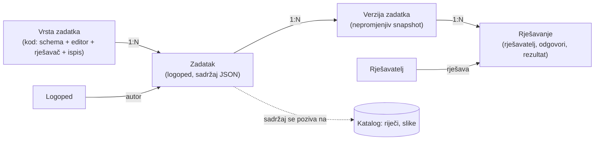

# Zadaci: predlošci, instance, rješavanja

Status (2026-10-31): baza (`migrations/0004_zadaci.sql`) i admin za sve četiri vrste su na produkciji
(`/admin/zadaci`): editor, pregled „Dijete rješava” i A4 ispis. Djeca i spremanje rješavanja još nemaju UI. Vrste zadataka se dopisuju
u odjeljak „Vrste zadataka” kako ih Matija opisuje.

## Opseg (odluka 2026-10-31)

Ova aplikacija je **samo admin**: izrada strukture sadržaja (katalog, vrste zadataka, zadaci).
Aplikacije za krajnje korisnike (logopedi, djeca) bit će zasebni frontendi koji čitaju isti
sadržaj preko API-ja. Zato se pitanja tko rješava, uvoz starih korisnika i prijava logopeda
odgađaju do prvog takvog frontenda. Model ih i dalje predviđa (`autor_id`, `rjesavanja`), ali se
sada ne grade.

Analiza starih listića i koji su podaci kvalitetni: `../preuzimanje/docs/legacy-kvaliteta.md`.

## Pojmovi

| Pojam | Što je | Tko ga stvara |
|---|---|---|
| **Vrsta zadatka** (predložak) | Tip zadatka: kakav sadržaj prima, kako se uređuje, rješava, ispisuje i boduje | developer, u kodu |
| **Zadatak** (instanca) | Jedna vrsta + konkretan sadržaj (riječi, slike, rečenice, naslov). Stari radni listić je jedna instanca vrste `listic` | logoped |
| **Rješavanje** | Jedan pokušaj jednog rješavatelja na jednoj verziji zadatka: odgovori, rezultat, vrijeme | rješavatelj |



## Odluke u modelu

1. **Vrsta zadatka živi u kodu, ne u bazi.** Svaka vrsta treba vlastiti editor, rješavač i
   ispis, pa je to TS modul (`src/zadaci/<kod>/`): `schema` (zod) za sadržaj, `Editor`,
   `Rjesavac`, `Ispis` (PDF/print) i `ocijeni(sadrzaj, odgovori)`. U bazi je samo `kod`.
2. **Sadržaj instance je JSON** validiran schemom vrste. Slike i riječi se referenciraju po
   `rijec_id` / `slika_id` iz kataloga, ne kopiraju; vlastiti tekst (rečenica umjesto naslova
   kartice) ide u JSON.
3. **Verzije.** Kad logoped uredi zadatak koji je već netko rješavao, nastaje nova verzija;
   rješavanja ostaju vezana uz verziju koju su vidjela. Inače bi stari rezultati značili nešto drugo.
4. **Listić = zadatak.** Stari listić (naslov + kartice slika/riječ) je vrsta `listic`; ispis
   kao danas, a rješavanje je opcionalno (vrsta može biti samo za ispis).
5. **Multiuser.** Svaki zadatak ima `autor_id`; vidljivost `privatno | dijeljeno | javno`
   (javno = drugi logopedi mogu kopirati u svoje, s `izvor_id`).
6. **Prijava logopeda nije Cloudflare Access.** Access ostaje za admin. Logopedi: e-mail
   (magic link / OTP) + passkey, ista mehanika kao admin sesije, zasebne tablice.
7. **Dijete nema račun (odluka 2026-10-31).** Zadatke uvijek ispunjava dijete s logopedom, na
   logopedovom uređaju, u logopedovoj sesiji. Logoped vodi svoju bazu djece; svako rješavanje
   bilježi koje dijete, koji zadatak (i verziju) i kada, pa se po djetetu vidi kronologija.
   Dijete pripada jednom logopedu i drugi logopedi ga ne vide. O djetetu se čuva minimum
   (nadimak ili šifra koju logoped razumije, godina rođenja, napomena), ne puno ime ni OIB:
   to su podaci o zdravlju maloljetnika (GDPR čl. 9).

## Implementacija

| Što | Gdje |
|---|---|
| Tablice | `migrations/0004_zadaci.sql` |
| Vrste: normalizacija, provjere, ocjena, generator | `src/lib/zadaci/vrste.ts` (+ test) |
| Ključ rime, slogovi | `src/lib/zadaci/rima.ts` (+ test) |
| Upiti, verzije | `src/lib/zadaci/baza.ts` |
| Editor, „Dijete rješava”, A4 ispis (DOM u pregledniku) | `src/lib/zadaci/klijent.ts`, `src/pages/admin/zadaci/[id].astro` |
| PDF za ispis (u pregledniku, pdf-lib + fontkit) | `src/lib/pdf/`: `model.ts` (stranice), `ispis-pdf.ts` (crtanje, + test), `svg.ts` (bor i grančice kao vektor), `preglednik.ts` (fontovi, slike, preuzimanje); slike s CDN-a kroz `/cdn/<ključ>` (`src/pages/cdn/[...kljuc].ts`) |
| API | `POST /admin/api/zadatak` (novi), `POST /admin/api/zadatak/:id` (JSON spremi, form obriši), `POST /admin/api/rijeci` (nova riječ) |

**PDF.** Glavni ispis je „Preuzmi PDF” (pogled Ispis u editoru i `/b/<slug>/ispis`), kao u starom
LogoMedu (pdfmake). PDF se slaže u pregledniku: Nunito 800/900 iz `public/fonts/` kao podskup (hrvatska
slova), slike smanjene na ≤ 800 px JPEG (PDF bilježnice ~1–2 MB, ne 6 MB), raspored kao HTML ispis
(odabir 3 reda, uljez 4, povezivanje 1 stranica, listić 3 × 4). Slike idu kroz `/cdn/` jer
cdn.logomedo.com nema CORS, a CSP stranice dopušta `connect-src 'self'`. „Ispiši” (dijalog preglednika)
ostaje kao sporedni gumb.

Izmjereno na produkciji 1. 11. 2026. (Božićna rima, 6 stranica, 14 slika): 1009 KB, ~1,5 s od klika.
Bez smanjivanja slika isti PDF ima 5,8 MB. Zamke: u `drawSvgPath` pdf-lib skalira i debljinu crte i
crtkanje (pišu se u SVG jedinicama, ne u točkama); `color` bez `borderWidth` samo puni, bez obruba. U
lokalnom devu prvi `import()` pdf-lib-a zna izazvati Vite reload stranice (optimizacija ovisnosti).
Gumb u admin editoru nije isproban u pregledniku (prijava passkeyem), dijeli kod s javnim ispisom.

U editoru se slika bira iz cijelog kataloga (pretraga po riječi ili `-rima`, filtri „rimuje se / ne rimuje
se s …”); riječ koje nema može se odmah dodati u katalog (bez glasa), a slika joj se generira na
stranici riječi. Dok riječ nema sliku, prikazuje se riječ.

## Skica tablica (D1)

```sql
korisnici        (id, email UNIQUE, ime, uloga 'logoped'|'admin', legacy_uid, created_at)
zadaci           (id, autor_id, vrsta, naslov, vidljivost, izvor_id, aktivna_verzija, created_at, updated_at, obrisan_at)
zadatak_verzije  (zadatak_id, verzija, sadrzaj JSON, created_at, PRIMARY KEY (zadatak_id, verzija))
djeca            (id, logoped_id, nadimak, godina_rodenja, napomena, created_at, arhivirano_at)
rjesavanja       (id, logoped_id, dijete_id, zadatak_id, verzija, odgovori JSON, rezultat, zapoceto_at, zavrseno_at)
-- kronologija djeteta: INDEX rjesavanja (dijete_id, zapoceto_at)
-- logoped_id je u rješavanju i kad dijete kasnije prijeđe drugom logopedu: tko je vodio taj sat
```

Nema tablice dodjela ni poveznica: dijete ne dobiva zadatke izvan sata kod logopeda. Ako se
kasnije uvede „plan terapije” (koji zadaci za koje dijete), to je zasebna tablica, ne preduvjet.

## Otvorena pitanja (odgođeno do frontenda za krajnje korisnike)

1. ~~Tko rješava?~~ Riješeno: odluka 7.
2. **Stari korisnici** (130 u Auth, s scrypt hashevima): uvesti s istim lozinkama, uvesti samo
   e-mailove (prijava novim načinom), ili krenuti od nule?
3. **Stari listići** (468): uvesti kao zadatke vrste `listic` njihovim autorima?

## Područja (taksonomija)

Područje → podpodručje je podatak u bazi (admin ga uređuje), vrsta zadatka je kod. Jedna vrsta
može služiti u više podpodručja.

| Područje | Podpodručje | Vrste |
|---|---|---|
| Korekcija artikulacije | glas × pozicija (postojeći katalog) | `listic` |
| Predvještine čitanja i pisanja | Prepoznavanje rime | `odabir`, `povezivanje`, `uljez` |

```sql
podrucja  (id, roditelj_id, naziv, slug, redoslijed)   -- stablo, 2 razine zasad
zadaci    (..., podrucje_id)                           -- podpodručje kojem instanca pripada
```

## Vrste zadataka

**Mehanika je vrsta, odnos je parametar.** Tri zadatka za rimu su tri mehanike: odaberi jedan od
ponuđenih, poveži parove, pronađi uljeza. Rima je samo odnos po kojem je sadržaj složen. Iste
mehanike kasnije nose „isti prvi glas”, „isti broj slogova”, „isti zadnji glas”, pa se ne pišu
tri nova modula. Zato:

- sadržaj instance **eksplicitno** sadrži točan odgovor (koju sliku, koji par), ne računa se pri
  rješavanju; logoped ima zadnju riječ, a automatsko prepoznavanje rime je samo pomoć pri izradi
- `odnos` (`rima`, ...) je polje sadržaja: služi generatoru, filtriranju i opisu, ne ocjenjivanju
- jedna instanca ima **više stavki** (redaka), kao listić: 4–6 redaka je jedna stranica ispisa
- rješavanje bilježi **što je dijete odabralo**, ne samo točno/netočno: koji distraktor zbunjuje
  je logopedu korisna informacija

Svaka slika je `rijec_id` iz kataloga (slika se bira po stilu pri prikazu).

### `odabir`: zadana slika, odaberi onu koja se rimuje

Gore jedna slika, ispod tri; jedna se rimuje sa zadanom.

```ts
{ odnos: 'rima', stavke: [{ zadana: rijec_id, ponudeno: [rijec_id, rijec_id, rijec_id], tocno: 0..2 }] }
odgovori: [{ stavka, odabrano: 0..2, ms }]
```
Ispis: zaokruži. Distraktori se ne smiju rimovati sa zadanom (provjera u editoru).

### `povezivanje`: dva stupca, poveži parove koji se rimuju

```ts
{ odnos: 'rima', parovi: [{ lijevo: rijec_id, desno: rijec_id }], desno_redoslijed: [indeks_para, ...] }
// lijevi stupac ide redom parova; desni po desno_redoslijed (spremljen, isti na ekranu i papiru)
odgovori: [{ lijevo: i, desno: k, ms }]   // svaki pokušani spoj, i krivi; k = mjesto u desnom stupcu
```
Ispis: crte između stupaca. 3–5 parova. Nijedna slika iz `lijevo` ne smije se rimovati s dvije iz `desno`.

### `uljez`: četiri u redu, tri se rimuju, jedna ne

```ts
{ odnos: 'rima', stavke: [{ slike: [rijec_id ×4], uljez: 0..3 }] }
odgovori: [{ stavka, odabrano: 0..3, ms }]
```
Ispis: prekriži uljeza.

### Rima u katalogu

Polje `rijeci.rima`: NULL znači ključ iz pravopisa (`src/lib/zadaci/rima.ts`), upisano znači ručni
ispravak (na stranici riječi). Broj slogova se računa, ne sprema. Automatski prijedlog: od zadnjeg
samoglasnika ako riječ završava suglasnikom (DABAR, ORMAR → `AR`), od predzadnjeg ako završava
samoglasnikom (KRAVA, TRAVA → `AVA`); slogotvorno R se broji kao samoglasnik (CRKVA). Admin
može ključ prepisati. Na postojećih 632 riječi to daje ~40 skupina s ≥2 riječi (AR, AC, AK, OR,
AČ, IR, AN, ICA, ANJE, INA, AVA, ADA...).

Ograničenja koja treba znati:
- katalog je složen za artikulaciju (riječi s C, Č, L, R, S, Š, Z, Ž), pa nema tipičnih kratkih
  rima za predškolce (MIŠ–KIŠ, MED–LED, KOZA–ROZA). Za rimu treba dodati riječi; riječ
  u katalogu ne mora imati glas (`rijec_glas` je opcionalan)
- pravopisni ključ ne zna naglasak, pa je prijedlog, ne istina; editor upozorava, admin ispravlja
- složenice daju prelake rime (KIŠOBRAN–PADOBRAN): editor ih označi

### Generator

Novi zadatak se odmah složi (4 stavke, do 3 sloga); u editoru „Složi automatski” s brojem stavki,
„najviše 3 sloga” i „samo riječi sa slikom”. Generator (`slozi()` u `vrste.ts`) uzme skupine rima i nasumične distraktore
iz drugih skupina. Admin onda mijenja pojedinu sliku. Spremljen je samo rezultat, ne seed.

### `listic`: radni listić slika

Naslov + niz kartica (slika iz kataloga + uređivi tekst ispod). Ispis PDF. Prijenos starog
`working-sheets` dokumenta: `header.title` → `naslov`, `cards[].header.title` → tekst kartice,
`cards[].body.image` → `rijec_id` po staroj putanji iz `preuzimanje/data/catalog.csv`.
