# Zvukovi: izgovor kroz ElevenLabs

Igra bilježnice (`/b/<slug>`) izgovara riječi, upute i rečenicu na kraju. Do 4. 11. 2026. to je
radio samo glas preglednika (`speechSynthesis`), loše za hrvatski. Sada svaki tekst dobiva
snimku iz ElevenLabsa, koja prolazi automatsku provjeru i ljudski pregled. Glas preglednika
ostaje zamjena dok tekst nema odobrene snimke.

```mermaid
flowchart LR
  A["/admin/biljeznice/:id<br/>Generiraj zvukove"] --> B[(zvuk_generiranja<br/>ceka)]
  B -->|Cloudflare Queue<br/>logomedo-zvukovi| C[Worker queue&#40;&#41;]
  C --> D[ElevenLabs TTS<br/>eleven_v3, hr]
  D --> E[Scribe STT<br/>prijepis]
  E -->|riječ točno /<br/>rečenica ≥ 90 %| F[(zvukovi<br/>kandidat)]
  E -->|razlika| G[(zvukovi<br/>odbijen, automatski)]
  G -->|pokušaj < 3| D
  G -->|3. pokušaj| F2[najbolji → kandidat<br/>oznaka „razlika”]
  F --> H["/admin/zvukovi<br/>slušaj, odobri / odbij"]
  F2 --> H
  H -->|odobri| I[R2 JAVNO → cdn.logomedo.com/zvuk/…]
  H -->|odbij + razlog<br/>+ kako izgovoriti| B
  I --> J["/b/:slug<br/>zvukovi: { ključ: URL }"]
```



## Zašto ovako

- **Bez runnera na Macu.** Slike idu kroz `scripts/runner.sh`, jer Vertex treba gcloud prijavu.
  ElevenLabs treba samo API ključ, pa posao radi sam Worker (consumer reda u `src/worker.ts`).
- **D1 je izvor istine, Queue je samo okidač.** Ako se poruka izgubi, posao ostaje `ceka`;
  „Pogurni red” na `/admin/zvukovi` ga ponovno šalje (i vraća zapele u `radi` dulje od 10 min).
- **Snimka pripada tekstu, ne bilježnici.** Ključ je tekst malim slovima s jednim razmakom
  (`kljucZvuka`), pa „ČAJ” u sceni i „čaj” na kartici dijele snimku, kao i sve bilježnice.
- **Automatska provjera (klasifikacija).** Scribe prepiše snimku. Riječ (do dvije) mora biti
  prepisana točno, s dijakriticima, jer krivi glas u riječi je ono što logoped ne smije čuti.
  Rečenica smije imati ≥ 90 % sličnosti (Levenshtein), jer STT griješi u sitnicama. Ako STT ne
  radi, snimka ide čovjeku s oznakom „bez provjere”.
- **Čovjek odlučuje.** Javno ide samo `odobren`. Odbijanje traži razlog i nudi polje „kako
  napisati za izgovor” (npr. drugačiji pravopis ili naglasak), koje ide u novi posao.

## Dijelovi

| Što | Gdje |
|---|---|
| Shema, postavke `zvuk_glas` i `zvuk_model` | `migrations/0021_zvukovi.sql` |
| Ključ, tekst za TTS, usporedba (čisti TS, + test) | `src/lib/zvukovi-tekst.ts` |
| TTS, STT, popis glasova | `src/lib/elevenlabs.ts` |
| Red, obrada, odluke, CDN | `src/lib/zvukovi.ts` |
| Consumer | `src/worker.ts` (`queue`), `wrangler.jsonc` (`queues`) |
| Pregled, glas, proba glasa | `src/pages/admin/zvukovi.astro`, `src/pages/admin/api/zvuk-proba.ts`, `src/pages/admin/zvuk/[id].ts` |
| Bilježnica | `tekstoviBiljeznice()` u `src/lib/biljeznice.ts`, odjeljak „Izgovor” u `/admin/biljeznice/[id]` |
| Igra | `src/pages/b/[slug].astro` (`zvukovi`), `govori()` u `src/lib/biljeznice-igra.ts` |

Tekst za TTS (`izgovorZa`) ima veliko slovo na početku rečenice i točku na kraju: riječ
VELIKIM slovima model zna čitati kao kraticu, a gola riječ dobiva nedovršenu intonaciju.

Igra svira sve snimke kroz jedan `Audio` element, otključan u dodiru „Kreni” (iOS). Ako snimka
ne krene (mreža, format), jednom padne na glas preglednika. `AbortError` (sljedeći tekst je
prekinuo prethodni) nije greška.

## Glas

Glas je postavka (`/admin/zvukovi` → Glas), vrijedi za nove poslove. Uz „Poslušaj probu” se
glas čuje prije spremanja; proba se ne sprema. Popis glasova traži dozvolu ključa `voices_read`,
a bez nje se upisuje `voice_id`.

Proba 4. 11. 2026. s engleskim glasom (Rachel): rečenice dobro, a riječi sa Š, Č, Ž, NJ i IJE
loše („Šal” → „Shaw”, „Trubač” → „True Butch”, „Snijeg” → „Снег”). STT je uhvatio sve. Treba
izvorni hrvatski glas iz Voice Libraryja ili kloniran (Instant: 1–2 min čiste snimke;
Professional: 30+ min). Za glas logopedice treba njezina izričita suglasnost.

## Produkcija

```bash
npx wrangler queues create logomedo-zvukovi
npx wrangler secret put ELEVENLABS_API_KEY        # ključ s text_to_speech, speech_to_text (+ voices_read)
npm run db:migrate && npm run deploy
```

Trošak: jedan posao je 1–3 TTS poziva (znakovi teksta) i isto toliko STT poziva. Bilježnica
od 33 teksta je ~600 znakova po krugu.
