# Zvukovi: izgovor kroz ElevenLabs

Igra bilježnice (`/b/<slug>`) izgovara riječi, upute i rečenicu na kraju. Do 4. 11. 2026. to je
radio samo glas preglednika (`speechSynthesis`), loše za hrvatski. Sada svaki tekst dobiva
snimku iz ElevenLabsa, koja prolazi automatsku provjeru i ljudski pregled. Od 14. 11. 2026. glasa
preglednika više nema: tekst bez odobrene snimke nema zvučnik i samo se čita.



```mermaid
flowchart LR
  A["/admin/biljeznice/:id<br/>Generiraj zvukove"] --> B[(zvuk_generiranja<br/>ceka)]
  B -->|Cloudflare Queue<br/>logomedo-zvukovi| C[Worker queue&#40;&#41;]
  C --> D[ElevenLabs TTS<br/>eleven_v3, hr]
  D --> E[Scribe STT<br/>prijepis]
  E -->|riječ točno /<br/>rečenica ≥ 90 %| F[(zvukovi<br/>kandidat)]
  E -->|razlika| G[(zvukovi<br/>odbijen, automatski)]
  G -->|pokušaj < 3| D
  G -->|3. pokušaj| F2[najbolji → kandidat<br/>oznaka „razlika”]
  F --> H["/admin/zvukovi<br/>slušaj, odobri / odbij"]
  F2 --> H
  H -->|odobri| I[R2 JAVNO → cdn.logomedo.com/zvuk/…]
  H -->|odbij + razlog<br/>+ kako izgovoriti| B
  I --> J["/b/:slug<br/>zvukovi: { ključ: URL }"]
```

## Zašto ovako

- **Bez runnera na Macu.** Slike idu kroz `scripts/runner.sh`, jer Vertex treba gcloud prijavu.
  ElevenLabs treba samo API ključ, pa posao radi sam Worker (consumer reda u `src/worker.ts`).
- **D1 je izvor istine, Queue je samo okidač.** Ako se poruka izgubi, posao ostaje `ceka`;
  „Pogurni red” na `/admin/zvukovi` ga ponovno šalje (i vraća zapele u `radi` dulje od 10 min).
- **Snimka pripada tekstu, ne bilježnici.** Ključ je tekst malim slovima s jednim razmakom
  (`kljucZvuka`), pa „ČAJ” u sceni i „čaj” na kartici dijele snimku, kao i sve bilježnice.
- **Automatska provjera (klasifikacija).** Scribe prepiše snimku. Riječ (do dvije) mora biti
  prepisana točno, s dijakriticima, jer krivi glas u riječi je ono što logoped ne smije čuti.
  Rečenica smije imati ≥ 90 % sličnosti (Levenshtein), jer STT griješi u sitnicama. Ako STT ne
  radi, snimka ide čovjeku s oznakom „bez provjere”.
- **Čovjek odlučuje.** Javno ide samo `odobren`. Odbijanje traži razlog i nudi polje „kako
  napisati za izgovor” (npr. drugačiji pravopis ili naglasak), koje ide u novi posao.
  „Samo odbij” ne pravi novi posao i označi snimku `bez_ponavljanja`: za riječi koje ElevenLabs
  ne zna izgovoriti. Takav tekst preskače i „Generiraj zvukove” na bilježnici, dok ga netko ne
  vrati „Generiraj ponovno” na tabu Odbijeni (`migrations/0024_zvuk_bez_ponavljanja.sql`).

## Kratke riječi: načini izgovora (14. 11. 2026.)

Na produkciji (glas Elena, `eleven_v4`) kratke riječi su se čule engleski: „Led.” → „Lead” (9 od
9 pokušaja), „Dim.” → „Dimenzija”, „Šal.” → „Shall”, „Dar” s engleskim R. Odbijanje je samo
ponovilo isti poziv, pa isti rezultat. Pokus (Scribe kao sudac):

| riječ | v4 | v4 + kontekst | multilingual v2 + kontekst |
|---|---|---|---|
| led | Lead | Lead | Led |
| dim | Dimenzija | Dimenzija | Dim |
| šal | Shall | Shall | Šal |
| bal | Ball | Bal | Bal |
| kamper | Camper | Kamper | Kamper |

Zato snimka pamti **način** (`zvukovi.nacin`, migracija 0030): `model`, `model+kontekst`
(`previous_text` „Ovo je hrvatska riječ:”; v3 ga ne podržava) ili `model+rez` (rečenica „Reci
riječ: led.” kroz `/with-timestamps`, pa `src/lib/mp3.ts` odreže MP3 okvire prije riječi).
`naciniZa()` u `zvukovi-tekst.ts`: riječ (do dvije) ide multilingual v2 s kontekstom → izrezano →
glavni model; rečenica glavni model → glavni model → multilingual v2. i-ti pokušaj uzima i-ti način.

Kad čovjek odbije snimku, novi posao ima `varijante = 1`: snime se **sva tri načina** i sva idu u
pregled (i ona koju STT ne čuje točno), a čovjek bira. „Odobri” jednu odbije ostale iz skupine
(„odabrana druga snimka”).

Scribe kratku riječ zna prepisati ćirilicom („дим”, „Бал”, „Конь”) iako je izgovor dobar:
`zaUsporedbu` je prvo preslovi (`latinica`).

## Snimke glasova (/admin/zvukovi/snimke, 18. 11. 2026.)

Zadaci „Koje slovo čuješ?” i „Gdje je glas?” trebaju **izolirani glas** („sss”, ne „es”), što ElevenLabs ne zna. Zato
ga snima logopedica: 30 kartica (abeceda, LJ/NJ/DŽ su jedan glas), „Snimi” → „Stani”, preslušaj, „Spremi”.

- Preglednik snimku (MediaRecorder) dekodira, obreže tišinu (prag 8 % vršne glasnoće, 40 ms rezerve), izjednači na
  −1 dBFS s mekim rubovima i pretvori u 24 kHz mono WAV (oko 50 kB/s). Preslušavanje prije spremanja ide kroz
  WebAudio, jer CSP ne dopušta `blob:` u `<audio>`.
- Server provjeri RIFF/WAVE i veličinu (do 2 MB), spremi u R2 (`zvuk/<hash>.wav`) i upiše red u `zvukovi`:
  `kljuc = '/s/'`, `model = 'snimka'`, `status = 'odobren'` (odmah javno).
- **Varijante (20. 11. 2026., migracija 0041):** glas može imati više odobrenih snimki (kratko/produljeno, sa i bez
  šva…). Stupac `primarna` (djelomični UNIQUE po `kljuc`: najviše jedna) kaže koju igra pušta; `oznaka` je kratki
  opis varijante. Prva snimka glasa postaje primarna, sljedeće su varijante (ili primarne, uz kvačicu „neka bude
  primarna”). ★ na kartici mijenja primarnu, ✕ briše jednu varijantu; ako je bila primarna, primarna postaje
  najnovija preostala. `odobreniZvukovi` slaže `ORDER BY primarna, id`, pa primarna pobijedi. Do 0041 nova snimka
  je zamijenila staru („zamijenjen novijom”); te ostaju odbijene.
- Igra ih dobiva istim putem kao izgovor (`odobreniZvukovi`), ključevi iz `glasoviIgre()` u `biljeznice-ekrani.ts`.
- Snimke ne ulaze u ElevenLabs: `dodajZvukove` i `ponoviZvuk` preskaču ključeve `/x/`, a tabovi Izgovora ne
  prikazuju `model = 'snimka'`.

## Stranica Izgovor (/admin/zvukovi)

Po dizajnu „1.3 Odobravanje izgovora”: kartica po tekstu sa svim snimkama, tabovi Čeka / Odobreno
/ Odbijeno / Nije uspjelo s brojevima. Odluke idu `fetch`om (zaglavlje `x-ajax`, odgovor JSON), bez
ponovnog učitavanja: odobrena kartica nestane, scroll ostaje. Odbijena kartica ostaje **na istom
mjestu** („Snima se…”), jer se kartice slažu po prvoj snimci teksta, a stranica svakih 5 s u
pozadini dohvaća samu sebe i mijenja kartice u izradi. Bez JS-a forme rade s redirectom.

## Izbor glasa (/admin/zvukovi/glasovi)

Glas koji čita, model za rečenice i **probe glasova**: svaki glas iz ElevenLabs knjižnice
(hrvatski) i računa na stalnom testnom skupu (`TEST_SKUP`, riječi koje su padale; postavka
`zvuk_test_skup` ga mijenja) i odabranom načinu. Proba se trajno sprema (`zvuk_probe`, mp3 u R2
`proba/<hash>.mp3`), pa ponovno slušanje i usporedba ne koštaju. Uz svaku probu 👍/👎 i „zašto?”,
uz glas ocjena i napomena (`zvuk_glas_biljeske`, migracija 0031). Rang glasova (`bodovi()` u
`src/lib/zvuk-probe.ts`): ocjena glasa, ocjene proba, STT točnost i odluke na /admin/zvukovi za
taj glas. Točke u retku glasa su regresija na skupu: zelena = STT točno, crvena = čuje drugo,
obrub = tvoja ocjena.

## Dijelovi

| Što | Gdje |
|---|---|
| Shema, postavke `zvuk_glas` i `zvuk_model` | `migrations/0021_zvukovi.sql` |
| Ključ, tekst za TTS, usporedba (čisti TS, + test) | `src/lib/zvukovi-tekst.ts` |
| TTS, STT, popis glasova | `src/lib/elevenlabs.ts` |
| Red, obrada, odluke, CDN | `src/lib/zvukovi.ts` |
| Consumer | `src/worker.ts` (`queue`), `wrangler.jsonc` (`queues`) |
| Načini, rez MP3 | `naciniZa`, `snimi()` u `src/lib/elevenlabs.ts`, `src/lib/mp3.ts` |
| Pregled | `src/pages/admin/zvukovi.astro`, `src/pages/admin/zvuk/[id].ts` |
| Glas, probe, ocjene | `src/pages/admin/zvukovi/glasovi.astro`, `src/lib/zvuk-probe.ts`, `src/pages/admin/api/zvuk-proba.ts` |
| Bilježnica | `tekstoviBiljeznice()` u `src/lib/biljeznice.ts`, odjeljak „Izgovor” u `/admin/biljeznice/[id]` |
| Igra | `src/pages/b/[slug].astro` (`zvukovi`), `govori()` u `src/lib/biljeznice-igra.ts` |

Tekst za TTS (`izgovorZa`) ima veliko slovo na početku rečenice i točku na kraju: riječ
VELIKIM slovima model zna čitati kao kraticu, a gola riječ dobiva nedovršenu intonaciju.

Igra svira sve snimke kroz jedan `Audio` element, otključan u dodiru „Kreni” (iOS). Ako snimka
ne krene (mreža, format), igra šuti.

## Glas

Glas je postavka (`/admin/zvukovi/glasovi`), vrijedi za nove poslove. Popis glasova traži dozvolu ključa `voices_read`,
a bez nje se upisuje `voice_id`.

Proba 4. 11. 2026. s engleskim glasom (Rachel): rečenice dobro, a riječi sa Š, Č, Ž, NJ i IJE
loše („Šal” → „Shaw”, „Trubač” → „True Butch”, „Snijeg” → „Снег”). STT je uhvatio sve. Treba
izvorni hrvatski glas iz Voice Libraryja ili kloniran (Instant: 1–2 min čiste snimke;
Professional: 30+ min). Za glas logopedice treba njezina izričita suglasnost.

### Proba hrvatskih glasova (4. 11. 2026.)

Glasovi iz Voice Libraryja (`/v1/shared-voices?language=hr`, filtar `language === "hr"`, jer API
na kraj popisa dodaje i druge jezike) rade u TTS-u izravno preko `voice_id`, bez dodavanja na
račun. Tekst: „Što se rimuje s riječi šal? Trubač, snijeg, sanjke, brijeg, zmaj, ježić, čaša,
džep, ćup, ljuljačka, njuška. Bravo!”, eleven_v3, prebrojene riječi koje je Scribe prepisao točno:

| Glas | voice_id | Točno |
|---|---|---|
| Ana (informativna) ž | `NfdaqpoTPn7nF7WBBRTv` | 12/12 |
| Nina ž | `FXlzTee7Zx2caYKIAwBF` | 12/12 |
| Mila ž | `eqAqnItEUARzEkoDCTJ1` | 12/12 |
| Ana (topla) ž | `rmUck1qkzTjuEjdC6Cav` | 12/12 |
| Zlata ž | `V5O4WAcdw7w3Ccfvma8Z` | 12/12 |
| Luka m | `ZLYZToA7aDsMbHwM9AOr` | 12/12 |
| Fran m | `TRnNlYQWHAJwo9K75wNE` | 12/12 |
| Karlo m | `pTD8166KADi6ZFJ5FEXi` | 12/12 |
| Maja ž | `0jvpZ98RZwx5FBOSZAc3` | 11/12 („sanke”) |
| Lara ž | `L1kQ6rz0P1bI4L5Av3Ow` | 11/12 („juljačka”) |
| Ivana (polako) ž | `JDYfAX20MbYfJGIjPTZz` | 11/12 („šab”) |
| Tomislav m | `O9XgmQnaZveORWl6mTHm` | 11/12 („juljačka”) |
| Branimir m | `WxQSzlR1UORgKEiMk1n4` | 11/12 („jet”) |

STT mjeri razgovijetnost, ne toplinu glasa za dijete: glas bira čovjek (Matija, Anita) po sluhu
na `/admin/zvukovi` → Hrvatski glasovi. Probe se spremaju u R2 (`proba/<hash>.mp3`, prijepis u
`customMetadata`), pa ponovno slušanje ne troši kvotu.

### Zamke

- Ključ je ograničen po dozvolama: bez `voices_read` i `/v1/voices` i `/v1/shared-voices` vraćaju
  401 `missing_permissions`. `user_read` (kvota) i `voices_write` (kloniranje preko API-ja) nema.
- CSP admina nema `blob:`, pa proba ne smije svirati `URL.createObjectURL`: audio svira isti GET
  URL (iz R2 cachea), a prijepis dolazi u zaglavlju `x-prijepis`.
- Port 8787 lokalno drži drugi projekt; `wrangler dev --port 8791`. `ADMIN_EMAILS` u `.dev.vars`
  je pod navodnicima, pa ih pri ručnom upisu sesije (docs/admin.md) treba skinuti.

## Produkcija

```bash
npx wrangler queues create logomedo-zvukovi
npx wrangler secret put ELEVENLABS_API_KEY        # ključ s text_to_speech, speech_to_text (+ voices_read)
npm run db:migrate && npm run deploy
```

Napravljeno 4. 11. 2026. (commit f40f17b). Glas na produkciji još nije odabran: poslovi tada
završe u grešci „Nije odabran glas”, a „Vrati greške u red” ih ponovno pokreće.

Trošak: jedan posao je 1–3 TTS poziva (znakovi teksta) i isto toliko STT poziva. Bilježnica
od 33 teksta je ~600 znakova po krugu.
